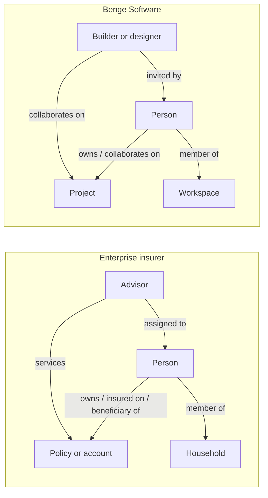

# Framing

## 1. One-Sentence Mission

Move marketing from one-off list pulls to one governed, identity-resolved, activation-ready foundation, so that a marketer can build an audience, send it to any channel and see the business outcome, without asking engineering to prepare the data first.

## 2. Problem Statement

The "before" state this design replaces:

- Each campaign starts with a list pull from a warehouse query or customer relationship management (CRM) report. The logic lives in someone's SQL file, and two teams pulling "active policyholders" get two different counts.
- Customer records are fragmented across policy admin, CRM, agency or advisor systems, web analytics and email platforms. No key joins them reliably.
- Marketo and Salesforce Marketing Cloud (SFMC) each hold their own copy of audiences and their own naming, so cross-channel suppression and frequency rules are manual.
- Consent and purpose rules are applied by hand at export time, if at all.
- Offline outcomes, such as a policy issued six weeks after an email, never make it back to the campaign that drove them.

## 3. Actors

| Actor | Enterprise example | Benge Software example | Needs |
|---|---|---|---|
| Person | Prospect, policyholder, beneficiary, household member | Homeowner, DIY builder | One profile, consistent treatment, respected consent |
| Professional | Financial advisor or agent | Small builder or designer | A clean book of business, warm leads, visibility into marketing touches |
| Marketer | Consumer and advisor marketing teams | Founder doing growth | Self-serve audiences and journeys, no data prep |
| Data product owner | Owner of a certified dataset or audience | Founder | Clear contracts, service level agreements (SLAs), adoption metrics |
| Data science | Propensity and next best action (NBA) models | Activation and churn scoring | Point-in-time features, a path to production |
| Steward, Privacy, Legal | Enterprise Data Office, Privacy Office | Founder plus outside counsel | Enforced purpose limitation, audit trail |
| Analytics | Marketing mix model (MMM), attribution, incrementality | Funnel and cohort analysis | Clean, joined outcome signal |

## 4. The Two-Sided Model

Both instances have the same shape: a **person** who buys, a **professional** who influences or completes the sale, and a **container** that groups people.

The concept map that the rest of this spec relies on:

| Concept | Enterprise | Benge Software |
|---|---|---|
| Person | Individual with any role | Account holder or invited collaborator |
| Professional | Advisor or agent (also a person) | Builder or designer (also a person) |
| Container | Household | Workspace or team |
| Holding | Policy, annuity, account | Project, subscription |
| Business unit | Line of business (life, retirement, group) | Product (`makeitours`, later products) |
| Conversion | Application submitted, policy issued | Project exported, subscription started |
| B2B channel | Marketo (advisor programs) | CRM outreach to builders |
| B2C channel | SFMC (consumer programs) | Lifecycle email and in-app messaging |

## 5. Invariants

These hold across every file in this folder. A design choice that would break one of them must change this list first.

1. **One person, one durable ID.** Every activated record carries an `enterprise_person_id` (Benge: `person_id`) issued by the identity spine. Channel IDs are attributes of that person, never the key.
2. **Relationships are edges, not columns.** Roles such as policyholder, beneficiary and advisor live on typed, time-bounded edges between entities. A person can hold several roles at once.
3. **Purpose is checked by the platform, not by the person exporting.** Every dataset and field that can reach an audience has a usage label. Every destination declares its marketing action. Activation fails closed when they conflict.
4. **Consent is evaluated at send time.** Consent captured after an audience is built still wins.
5. **Segments are code.** Each audience definition is versioned, reviewed and has an owner. A UI-built segment is promoted to code before it becomes a certified data product.
6. **The lakehouse is the system of record for derived data.** Adobe Experience Platform (AEP) holds a serving copy of what it needs for real-time use. Anything computed in AEP that matters later, such as segment membership or journey events, flows back to the lakehouse.
7. **Outcomes close the loop.** Every activation writes a send or exposure record with a campaign taxonomy key, so later outcomes can be joined back to it.
8. **Restricted data never enters the marketing profile.** Underwriting, health and claims detail stay in separate datasets with no marketing labels and no path to the profile.

## 6. Success Criteria (Targets)

| Measure | Target | Why it matters |
|---|---|---|
| Share of campaign audiences built from certified segments instead of list pulls | 80% within 12 months | The core behavior change |
| Time from audience request to first send | Under 1 business day for certified segments | Proves "no prep required" |
| Profiles with a resolved `enterprise_person_id` among known customers | Over 95% | Identity spine coverage |
| Duplicate person rate after resolution (sampled and steward-reviewed) | Under 2% | Identity precision |
| Activations blocked by policy that were actually legitimate | Under 1% | Governance is not a tax |
| Campaign sends with a joinable taxonomy key | 100% | Closed loop is possible |
| Offline conversions attributed back to a touch within 90 days | Over 70% of issued policies | Measurement is usable |

## 7. Non-Goals

- Replacing the Enterprise Data Office's master data management (MDM). This design consumes the MDM golden record where one exists and feeds match evidence back to it.
- Building a custom CDP. AEP stays the real-time profile and activation hub for the enterprise instance.
- Building production models in this spec. File 05 defines the contract and path, not the model internals.
