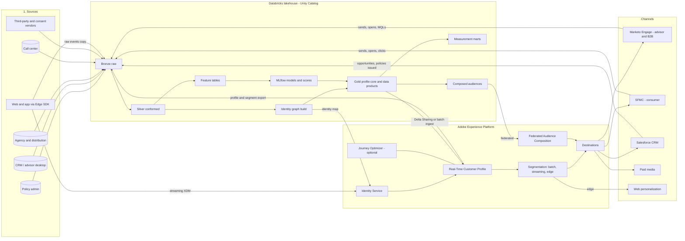
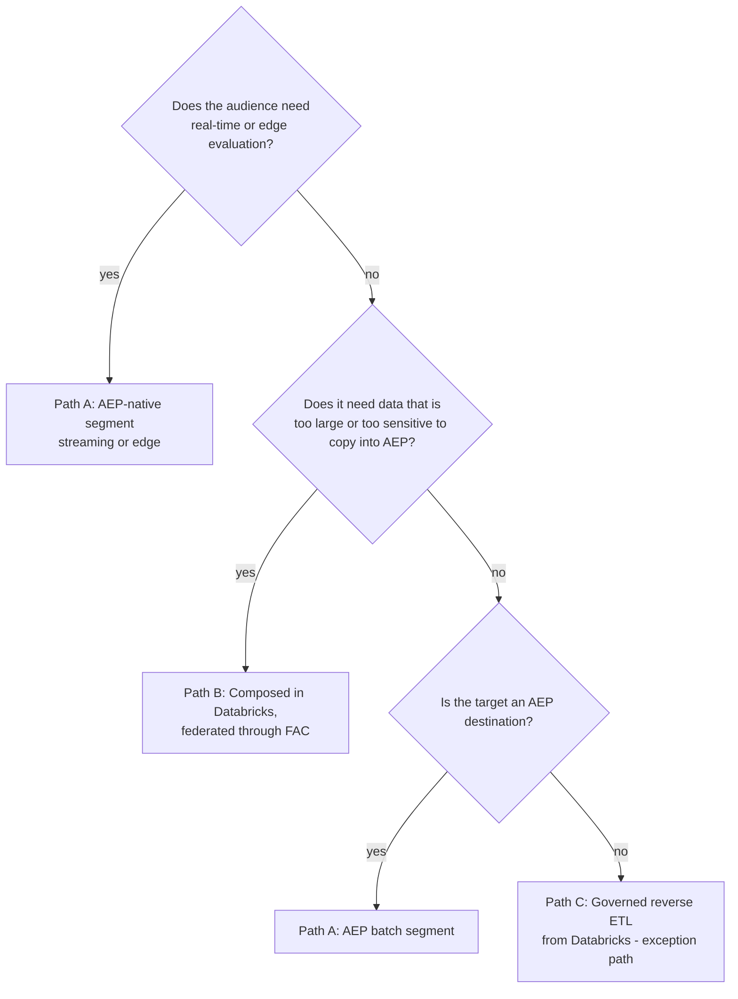

# Target Architecture

## 1. Overview

The architecture has six layers. Databricks owns the durable, governed, heavy computation. Adobe Experience Platform (AEP) owns the real-time profile, low-latency segmentation and the activation fabric. Marketo, Salesforce Marketing Cloud (SFMC) and the customer relationship management (CRM) are execution channels. Every layer writes evidence back to the lakehouse so measurement and governance see the whole loop.



## 2. What Lives Where

The rule of thumb: **Databricks computes, AEP serves.** AEP should not become a second warehouse, and Databricks should not try to be a real-time profile store for channel tools.

| Concern | Databricks | AEP | Why |
|---|---|---|---|
| Raw and history | Bronze, full history, replayable | Only what profile and segmentation need, with TTLs | Storage cost and AEP profile-richness limits |
| Identity | Offline graph build, survivorship, household and advisor edges, master data management (MDM) reconciliation | Identity Service graph for real-time stitching (ECID to CRM ID) | Complex matching needs SQL, Spark and audit; real-time stitching needs to be at the edge |
| Profile attributes | Golden record, computed traits, scores | Serving copy of approved attributes | Single source, small serving footprint |
| Behavioral events | All events, long retention | Recent events for streaming segments | Streaming segments need events in AEP |
| Segmentation | Complex, heavy or warehouse-only logic (composed audiences) | Real-time and streaming segments, edge segments | Use each where it is strong |
| Machine learning (ML) | Feature engineering, training, batch scoring, registry | Score attributes on the profile; Customer AI where licensed | AEP Data Science Workspace is no longer sold; custom ML belongs in Databricks |
| Activation | Governed exception path for bulk files to non-AEP targets | Primary path to all channels | One policy enforcement point |
| Measurement | Joins sends, exposures, journeys and outcomes | Source of segment and journey events | Analysts need the joined picture |
| Governance | Unity Catalog tags, attribute-based access control (ABAC), lineage | Data usage labels, marketing actions, consent policies | Enforced in both, from one label taxonomy (file 07) |

## 3. Integration Paths

### Lakehouse to AEP

| Path | Use for | Latency | Notes |
|---|---|---|---|
| Delta Sharing source | Profile attributes, scores, lookup tables from Unity Catalog | Scheduled, zero-copy read | Beta in Adobe docs as of Oct 2026 **(verify)**. Governance stays in Unity Catalog |
| Batch ingestion (cloud storage source or API) | Profile attributes and events where Delta Sharing is not enabled | Hourly to daily | The proven fallback; land Parquet in ADLS or S3 |
| Federated Audience Composition (FAC) | Audiences built from warehouse data without copying the full dataset into AEP | Scheduled | Databricks is a supported warehouse; can enrich AEP schemas with "Save field" |
| Streaming ingestion API | Server-side events that must drive streaming segments | Seconds | e.g. "application started" from the quote engine |

### AEP to the lakehouse

| What | How | Why |
|---|---|---|
| Profile snapshot and segment membership | Dataset export destination to cloud storage, ingested as Bronze | Lets Databricks measure audiences and detect drift between AEP and Gold |
| Identity graph changes | Export of identity data **(verify mechanism for the tenant)** | Reconcile AEP stitching with the offline graph |
| Journey and destination activity | Journey step events and destination flow runs | Exposure records for measurement |
| Channel engagement | Marketo and SFMC activity exports, Salesforce CDC | Closed loop (file 07) |

## 4. Three Ways an Audience Reaches a Channel



- **Path A** is the default. Policy enforcement, consent and destination mapping happen in one place.
- **Path B** keeps heavy or sensitive joins in Databricks. Only membership plus the minimum activation attributes cross into AEP, so data usage labels still apply at the destination.
- **Path C** exists for targets AEP cannot reach, such as a printer file for direct mail. It must call the same policy check service (file 04, section 5) and write the same send log. It needs an exception approval per use case.

## 5. Unity Catalog Layout

One catalog per environment, one schema per layer or domain. Tags drive both access control and the export to AEP labels.

```text
mktg_prod
├── bronze_*            raw sources, append only
├── silver_*            conformed, deduplicated, typed
├── identity            id_node, id_edge, id_cluster, person_xref, match_audit
├── profile             person_core, household, advisor, relationship, consent_current
├── features            feature tables (point-in-time)
├── ml                  scores, model metadata (registry lives in Unity Catalog)
├── audiences           segment_definition, segment_membership, audience_snapshot
├── activation          send_log, destination_run, suppression
└── measurement         touch, outcome, attribution_input, experiment_assignment
```

Restricted domains (underwriting, claims, health) live in a separate catalog with no grants to marketing principals. That separation is the first line of purpose limitation, ahead of any tag or label.

## 6. Latency Tiers

| Tier | Example use | Path | Target |
|---|---|---|---|
| Edge | Personalize the next page view | AEP edge segment | Under 100 ms at the edge |
| Streaming | Abandoned quote, call back within the hour | AEP streaming segment, streaming destination | Minutes |
| Daily | Cross-sell, lifecycle, advisor book refresh | AEP batch segment or Federated Audience Composition (FAC) | Ready by 7 a.m. local |
| Weekly or ad hoc | Model-driven campaigns, direct mail | FAC or governed reverse ETL | By planned send date |

## 7. Key Tradeoffs

- **Copy into AEP versus federate.** Copying gives streaming segments and edge use but costs profile richness and creates a second store. Federating keeps data in place but is batch only. Decision: copy only attributes needed for real-time or edge use; federate the rest.
- **One CDP hub versus warehouse-native activation.** A pure warehouse-native (composable) setup would retire AEP. That is not the brief. AEP's value here is real-time identity stitching, edge decisions and one governed destination layer. Databricks reduces how much AEP has to store.
- **Two marketing automation platforms.** Kept, with audiences and taxonomy owned upstream (file 04). Consolidating them is a separate business decision.

## 8. Upstream Asks

- Silver tables must expose source-system primary keys and change timestamps for every person-bearing entity (needed by file 02).
- Event streams must carry a stable device or browser ID plus any authenticated ID on the same record.
- Governance YAML in this repo must gain a `usage_labels` field per column (file 07).
