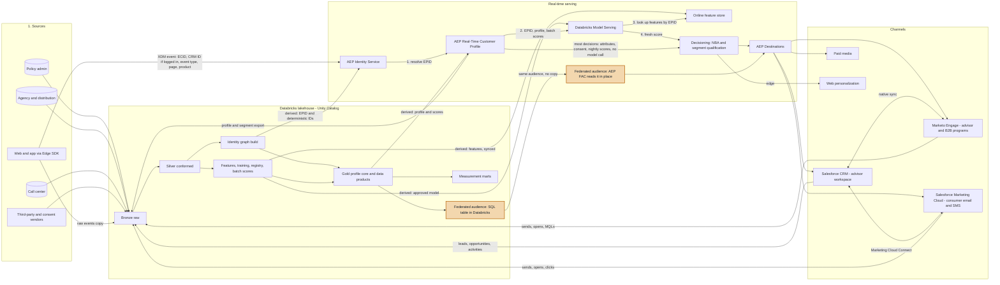
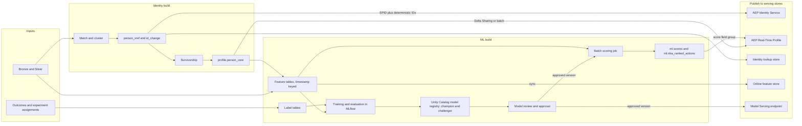
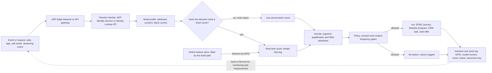
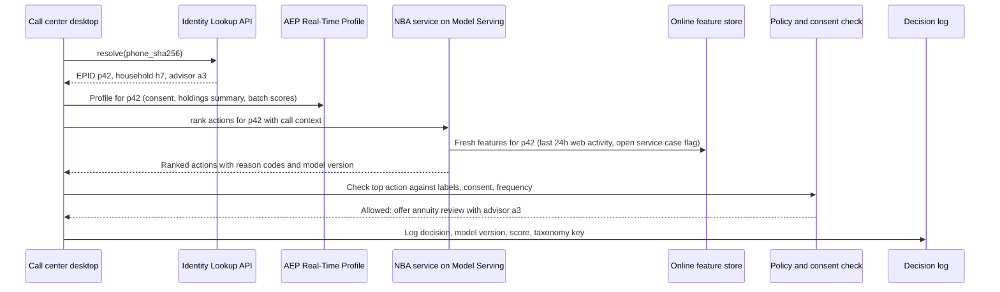
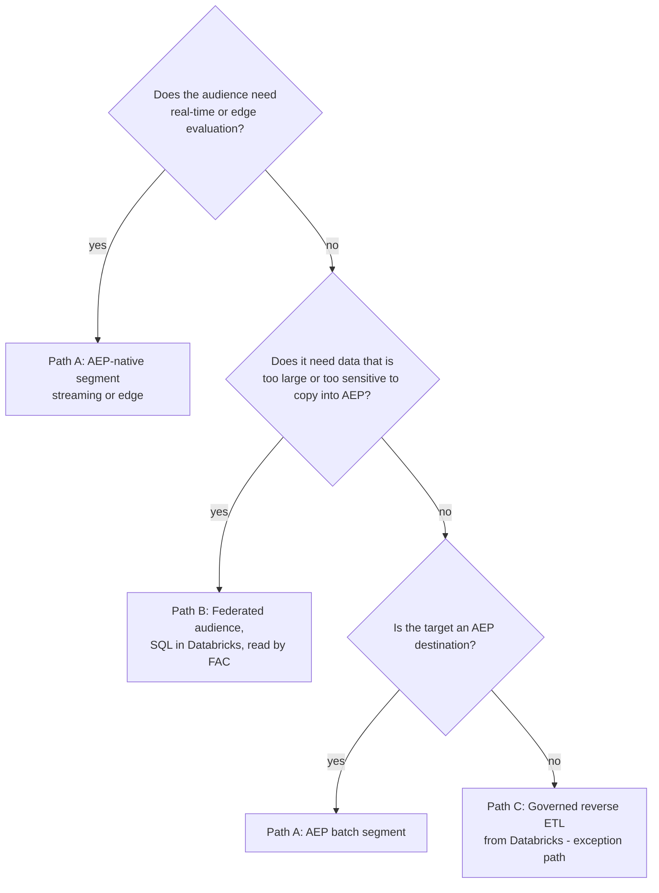
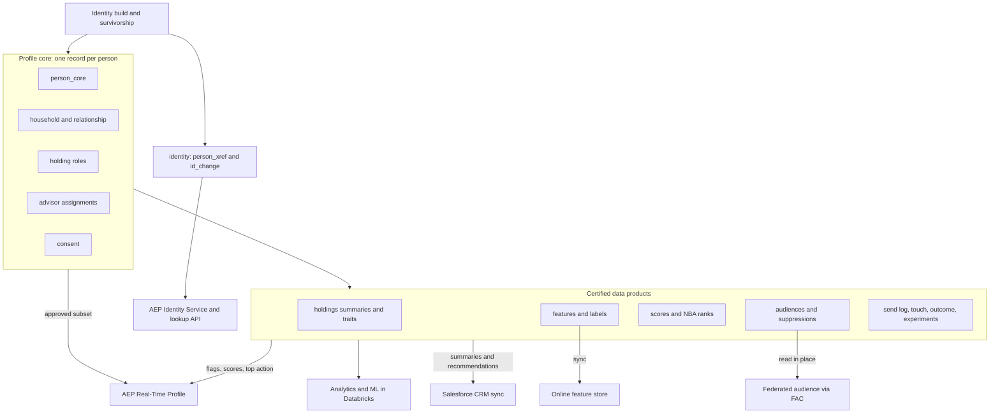

# Target Architecture

## 1. Overview

The architecture has six layers. Databricks owns the durable, governed, heavy computation. Adobe Experience Platform (AEP) owns the real-time profile, low-latency segmentation and the activation fabric. Marketo, Salesforce Marketing Cloud (SFMC) and the Salesforce customer relationship management (CRM) system are execution channels. Every layer writes evidence back to the lakehouse so measurement and governance see the whole loop.

The design has two paths, shown separately in sections 1.2 and 1.3:

- **The build path** runs on a schedule in Databricks. It resolves identity, builds the golden profile, trains and registers models, scores people in batch, and publishes identities, profiles and scores to the serving stores.
- **The serving path** runs per event or request. It resolves who the person is, reads their profile and scores (or scores them in real time), decides the next action, checks policy and consent, and acts in a channel.

### 1.1 Layer View



### What the Browser Sends to Edge

The Adobe Web SDK sends one small JSON event per page view or action to Adobe's Edge Network. Edge stores it in an AEP dataset and the Real-Time Profile, and answers with any personalization decision for the page. The same events are exported to Bronze. Example for a quote start:

```json
{
  "xdm": {
    "eventType": "quote.started",
    "timestamp": "2026-10-23T14:02:11Z",
    "identityMap": {
      "ECID":  [{ "id": "61580462...", "primary": true }],
      "CRMID": [{ "id": "c9", "authenticatedState": "authenticated" }]
    },
    "web": {
      "webPageDetails": { "name": "term-life-quote-step-1", "URL": "https://www.example.com/quote/term" }
    },
    "_tenant": {
      "quote": { "productLine": "term_life", "step": 1, "coverageBand": "500k-1m" }
    }
  }
}
```

| Part | Contents |
|---|---|
| Who | `ECID` (Adobe's browser ID, set by the SDK) and, after login, `CRMID`. That pair is what lets AEP link the anonymous visit to the known person. |
| What happened | `eventType`, timestamp, page name and URL, plus a few custom fields such as product line and quote step. |
| Added by the SDK | Browser, device and screen details, and the referring URL. |
| Raw input, not a feature | Fields like `coverageBand` are what the visitor entered on the page. Features such as "last coverage band quoted" or "quote starts in 30 days" are computed from these events in Databricks and reach serving only through the profile or the online feature store. `coverageBand` is financial information the consumer gave to get a quote, so it carries a `GLBA_NPI` label |
| Sent separately | Consent, through the SDK's consent command (for example collect = yes or no). Without consent the SDK sends nothing. |
| Never sent | Name, email, phone, date of birth, Social Security number, health or underwriting answers. Those stay in the quote system and reach Databricks through the build path. |

### What Is Allowed Into the Serving Path

| Data | Enters serving from | Why |
|---|---|---|
| Live web and app events, and the page or app request itself | The AEP Edge Network, as they happen | Needed to link an anonymous visitor to a known person at login, to qualify streaming segments such as quote abandonment, and to decide on the next page |
| Identities (`EPID`), profile attributes, scores, audiences, models | **Only the build path** | One writer for derived data, so serving never computes its own version of the truth |

Rule: raw behavioral events may stream into AEP; anything derived is written only by the Databricks build path. The same events are copied to Bronze, so the build path sees everything the serving path saw. AEP-side computation on those raw events is limited to what real-time use needs (identity stitching, streaming segment qualification, computed attributes over recent events), and its results are exported back to Bronze.

The orange boxes are one federated audience: the SQL table in Databricks, and the AEP Federated Audience Composition (FAC) audience that reads it in place without copying it.

### 1.2 Build Path

Everything here runs on a schedule, is replayable from Bronze, and publishes versioned outputs. Nothing on this path is in the request path of a customer interaction.



| Stage | Cadence | Output | Gate before publish |
|---|---|---|---|
| Identity build | Incremental every few hours, full weekly | `person_xref`, `id_change`, `person_core` | Incremental vs. full diff under threshold; no giant clusters |
| Feature build | Daily, plus streaming features where needed | Timestamp-keyed feature tables | Freshness and null-rate checks |
| Training | On schedule (for example monthly) or on drift alert | MLflow run with data versions and metrics | Beats current champion on out-of-time validation |
| Registry | Per approved version | Unity Catalog model version with aliases `champion` and `challenger` | Model card, fairness checks, risk-tier sign-off (file 05, section 6) |
| Batch scoring | Daily by 05:00 | `ml.scores`, `ml.nba_ranked_actions` | Score contract tests ([examples/score_contract.yaml](./examples/score_contract.yaml)) |
| Publish | After each gate passes | AEP identities and profile attributes, lookup store, online features, serving endpoint | Label check: scores inherit input labels |

### 1.3 Serving Path

This runs per event or request. Most decisions use the batch scores already on the profile. A small set of moments (web visit, call center screen pop, quote abandonment) score in real time because the answer depends on what just happened.



Real-time scoring, step by step, for a call center screen pop:



Where each serving component runs:

| Step | Component | Latency target | Notes |
|---|---|---|---|
| Resolve identity | AEP Identity Service (web, app); Identity Lookup API (call center, CRM, server) | Under 50 ms at p99 for the lookup API | Both are fed by the same offline graph |
| Read profile | AEP Real-Time Profile (edge projection for web) | Edge: under 100 ms | Batch scores are profile attributes |
| Real-time score | Databricks Model Serving endpoint with the online feature store | Under 150 ms at p99 | Only for moments where recent behavior changes the answer |
| Decide | NBA service (Model Serving) for web and call center; AEP segments and journeys for channel triggers | Under 200 ms for interactive moments | Ranking inside Adobe Journey Optimizer decisioning is an option if licensed **(verify)** |
| Gate | AEP policy engine and consent for destinations; policy check service for direct calls | In line | Same label-to-policy table everywhere |
| Act and log | Channel plus decision log | Asynchronous log | Model version on every logged decision makes monitoring and audit possible |

### 1.4 Why SFMC and Salesforce CRM Appear Separately

They come from the same vendor but are separate products with separate data stores, and they do different jobs here.

| | Salesforce Marketing Cloud (SFMC) | Salesforce CRM (Sales, Service or Financial Services Cloud) |
|---|---|---|
| Job in this design | Sends consumer email, SMS and journeys at volume | The advisor's and service rep's workspace: contacts, households, leads, opportunities, tasks |
| Data store | Its own tenant: subscribers and data extensions | Core Salesforce objects |
| Who uses it | Consumer marketing | Advisors, inside sales, service |
| AEP connection | Destination for consumer audiences | Destination for advisor tasks and lead updates; source of outcomes via change data capture |
| Link between them | Marketing Cloud Connect syncs contacts and send results | Same connector, other direction |

Keeping them as separate boxes matters because audiences go to SFMC for sending, while outcomes (leads, opportunities, applications) come back from the CRM. Treating them as one system is a common source of duplicate contacts and mismatched subscriber keys. If the company also licenses Salesforce Data Cloud, its overlap with AEP needs an explicit decision about which one owns the profile **(verify licensing)**.

## 2. What Lives Where

The rule of thumb: **Databricks computes, AEP serves.** AEP should not become a second warehouse, and Databricks should not try to be a real-time profile store for channel tools.

| Concern | Databricks | AEP | Why |
|---|---|---|---|
| Raw and history | Bronze, full history, replayable | Only what profile and segmentation need, with TTLs | Storage cost and AEP profile-richness limits |
| Identity | Offline graph build, survivorship, household and advisor edges, master data management (MDM) reconciliation | Identity Service graph for real-time stitching (ECID to CRM ID) | Complex matching needs SQL, Spark and audit; real-time stitching needs to be at the edge |
| Profile attributes | Golden record, computed traits, scores | Serving copy of approved attributes | Single source, small serving footprint |
| Behavioral events | All events, long retention | Recent events for streaming segments | Streaming segments need events in AEP |
| Segmentation | Complex, heavy or warehouse-only logic (federated audiences) | Real-time and streaming segments, edge segments | Use each where it is strong |
| Machine learning (ML) | Feature engineering, training, batch scoring, registry | Score attributes on the profile; Customer AI where licensed | AEP Data Science Workspace is no longer sold; custom ML belongs in Databricks |
| Activation | Governed exception path for bulk files to non-AEP targets | Primary path to all channels | One policy enforcement point |
| Measurement | Joins sends, exposures, journeys and outcomes | Source of segment and journey events | Analysts need the joined picture |
| Governance | Unity Catalog tags, attribute-based access control (ABAC), lineage | Data usage labels, marketing actions, consent policies | Enforced in both, from one label taxonomy (file 07) |

## 3. Integration Paths

### Lakehouse to AEP

| Path | Use for | Latency | Notes |
|---|---|---|---|
| Delta Sharing source | Profile attributes, scores, lookup tables from Unity Catalog | Scheduled, zero-copy read | Beta in Adobe docs as of Oct 2026 **(verify)**. Governance stays in Unity Catalog |
| Batch ingestion (cloud storage source or API) | Profile attributes and events where Delta Sharing is not enabled | Hourly to daily | The proven fallback; land Parquet in ADLS or S3 |
| Federated Audience Composition (FAC) | Audiences built from warehouse data without copying the full dataset into AEP | Scheduled | Databricks is a supported warehouse; can enrich AEP schemas with "Save field" |
| Streaming ingestion API | Server-side events that must drive streaming segments | Seconds | e.g. "application started" from the quote engine |

### AEP to the lakehouse

| What | How | Why |
|---|---|---|
| Profile snapshot and segment membership | Dataset export destination to cloud storage, ingested as Bronze | Lets Databricks measure audiences and detect drift between AEP and Gold |
| Identity graph changes | Export of identity data **(verify mechanism for the tenant)** | Reconcile AEP stitching with the offline graph |
| Journey and destination activity | Journey step events and destination flow runs | Exposure records for measurement |
| Channel engagement | Marketo and SFMC activity exports, Salesforce CDC | Closed loop (file 07) |

## 4. Three Ways an Audience Reaches a Channel



- **Path A** is the default. Policy enforcement, consent and destination mapping happen in one place.
- **Path B** keeps heavy or sensitive joins in Databricks. Only membership plus the minimum activation attributes cross into AEP, so data usage labels still apply at the destination.
- **Path C** exists for targets AEP cannot reach, such as a printer file for direct mail. It must call the same policy check service (file 04, section 5) and write the same send log. It needs an exception approval per use case.

## 5. Unity Catalog Layout

One catalog per environment, one schema per layer or domain. Tags drive both access control and the export to AEP labels.

```text
mktg_prod
├── bronze_*            raw sources, append only
├── silver_*            conformed, deduplicated, typed
├── identity            id_node, id_edge, id_cluster, person_xref, match_audit
├── profile             person_core, household, advisor, relationship, consent_current
├── features            feature tables (point-in-time)
├── ml                  scores, model metadata (registry lives in Unity Catalog)
├── audiences           segment_definition, segment_membership, audience_snapshot
├── activation          send_log, destination_run, suppression
└── measurement         touch, outcome, attribution_input, experiment_assignment
```

Restricted domains (underwriting, claims, health) live in a separate catalog with no grants to marketing principals. That separation is the first line of purpose limitation, ahead of any tag or label.

### 5.1 Gold Layer Map

"Gold" in this design has two parts. **Profile core** is the golden record: one row per real person, keyed on `enterprise_person_id` (EPID), plus the households, relationships, holdings, advisor assignments and consent attached to that person. **Certified data products** are tables built on top of the profile core, each with an owner, a contract and a freshness SLA. A small, approved subset is published to AEP; everything else is read in place in Databricks.



| Part | Table | Grain | Built by | Read by | Sent to AEP? | Detail |
|---|---|---|---|---|---|---|
| Profile core | `profile.person_core` | One row per person (EPID), current | Identity build + survivorship | Everyone | Yes: approved attributes | 02 section 6 |
| Profile core | `profile.person_core_history` | Person by effective date | Identity build | Analytics, ML training | No | 05 section 2.2 |
| Profile core | `profile.household, household_member` | Household; member with role | Household rules (address, landline) | Segmentation, ML, CRM sync | household_id only | 02 section 2 |
| Profile core | `profile.relationship` | Person-to-person edge, effective-dated | Source relationships (beneficiary, payor) | Segmentation, ML | No | 02 section 2 |
| Profile core | `profile.holding_role_history` | Person, policy, role, effective-dated | Policy admin Silver | ML, segmentation, CRM summaries | Summary flags only | 02 section 2 |
| Profile core | `profile.advisor, advisor_assignment_history` | Advisor; person-advisor by date | Distribution and licensing systems | Routing, suppression, ML | Assigned advisor ID | 02 section 2, 06 section 5 |
| Profile core | `profile.consent_current (+ history)` | Person, channel, purpose | Consent platform feed | Activation gates, everyone | Yes: consent field group | 07 section 3 |
| Identity | `identity.person_xref` | Identifier to EPID | Identity build | AEP Identity Service, lookup API, CRM sync | Yes: deterministic IDs only | 02 section 5, section 8 |
| Identity | `identity.id_change` | Merge or split event | Identity build | AEP, CRM, audience recompute | Applied as re-keying | 02 section 5 |
| Data products | `profile.holdings_summary, household_holdings_summary` | Person; household | dbt on Gold | Segmentation, CRM, AEP | Yes: flags (hasAnnuity, etc.) | 03 example |
| Data products | `profile.traits` | Person (life stage, rollover window) | dbt on Gold | Segmentation, ML | Yes | 03 section 2 |
| Data products | `features.*` | Entity by as_of timestamp | Feature pipelines | Training, batch scoring, online store | No (synced to online store) | 05 section 2.4 |
| Data products | `ml.labels_*` | Entity, observation date, window | Data products with Analytics | Training | No | 05 section 2.2 |
| Data products | `ml.scores` | Person, model, version, scored_at | Batch scoring | AEP, NBA, monitoring | Yes: decile and reason code | 05 section 3 |
| Data products | `ml.nba_ranked_actions` | Person, ranked action | NBA batch job | AEP, CRM recommendations | Top action | 05 section 4.2 |
| Data products | `audiences.segment_membership, audience_snapshot` | Person, audience, version, date | Segments as code; AEP exports | FAC, measurement, ML | Via FAC or AEP segments | 03 section 9 |
| Data products | `audiences.suppression_*` | Person | Suppression rules | All activation | Yes: imported audience | 03 section 7 |
| Data products | `activation.send_log, destination_run` | Message; destination run | Channel feeds and AEP run records | Measurement, fatigue model | No | 04 section 8 |
| Data products | `measurement.touch, outcome` | Touch; lead, application, issue, lapse | Channel, CRM and policy admin feeds | Analytics, ML labels, monitoring | Outcome flags for suppression | 07 section 5 |
| Data products | `measurement.experiment_assignment, media_weekly` | Person, experiment, arm; week, geo, channel | Experiment service; spend feeds | Uplift, MMM, readouts | No | 05 section 4.2, 07 section 5 |


## 6. Latency Tiers

| Tier | Example use | Path | Target |
|---|---|---|---|
| Edge | Personalize the next page view | AEP edge segment | Under 100 ms at the edge |
| Streaming | Abandoned quote, call back within the hour | AEP streaming segment, streaming destination | Minutes |
| Daily | Cross-sell, lifecycle, advisor book refresh | AEP batch segment or Federated Audience Composition (FAC) | Ready by 7 a.m. local |
| Weekly or ad hoc | Model-driven campaigns, direct mail | FAC or governed reverse ETL | By planned send date |

## 7. Key Tradeoffs

- **Copy into AEP versus federate.** Copying gives streaming segments and edge use but costs profile richness and creates a second store. Federating keeps data in place but is batch only. Decision: copy only attributes needed for real-time or edge use; federate the rest.
- **One CDP hub versus warehouse-native activation.** A pure warehouse-native (composable) setup would retire AEP. That is not the brief. AEP's value here is real-time identity stitching, edge decisions and one governed destination layer. Databricks reduces how much AEP has to store.
- **Two marketing automation platforms.** Kept, with audiences and taxonomy owned upstream (file 04). Consolidating them is a separate business decision.

## 8. Upstream Asks

- Silver tables must expose source-system primary keys and change timestamps for every person-bearing entity (needed by file 02).
- Event streams must carry a stable device or browser ID plus any authenticated ID on the same record.
- Governance YAML in this repo must gain a `usage_labels` field per column (file 07).
