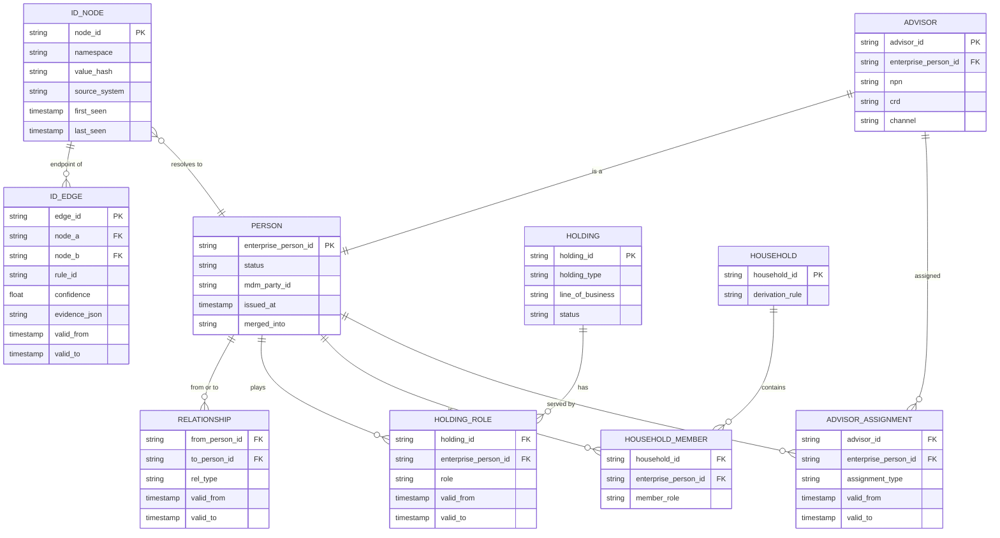
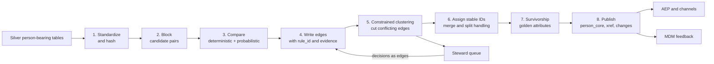
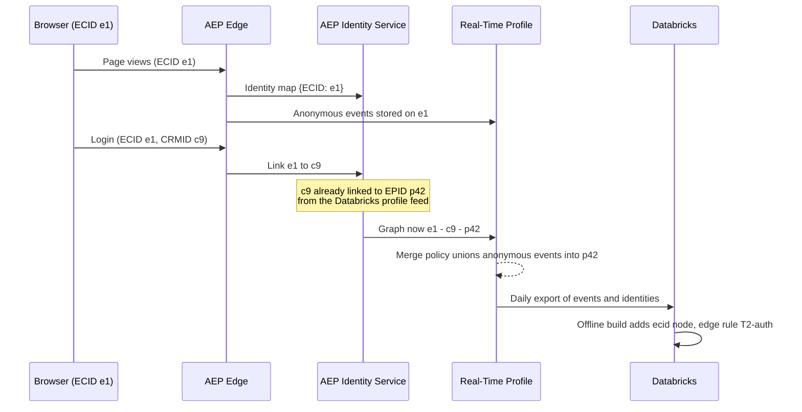

# Identity Spine

## 1. Purpose

Issue one durable `enterprise_person_id` for every real person the company knows about, in any role, and keep it stable as records arrive, change, merge and split. Model households and advisor relationships as typed edges between those people. Serve the result in two ways: an offline graph in Databricks that is the system of record, and a real-time path through Adobe Experience Platform (AEP) Identity Service and a lookup API.

## 2. Two Graphs, Not One

Keeping these separate is the most important modeling decision in this file.

- The **identity graph** answers "are these two records the same person?" Its edges are match evidence.
- The **relationship graph** answers "how are these people related to each other, to policies and to advisors?" Its edges are business facts.

Mixing them is how graphs collapse. A shared household email is evidence that two people are related, not that they are the same person.

Role values on `HOLDING_ROLE`: `owner`, `insured`, `annuitant`, `payor`, `beneficiary_primary`, `beneficiary_contingent`, `plan_participant`. A prospect is a person with no active holding role. A person who is both a policyholder and a beneficiary on a parent's policy has two rows, not two profiles.

Advisors are people too. An advisor who also owns a policy has one `enterprise_person_id` with an `ADVISOR` row attached. That matters for suppression: an advisor should not receive consumer cross-sell for products they sell.

## 3. Identifier Inventory

| Namespace | Example source | Strength | Normalization before hashing | Notes |
|---|---|---|---|---|
| `mdm_party_id` | Enterprise master data management (MDM) | Hard key | none | Treated as authoritative when present |
| `crm_contact_id` | Salesforce | Hard key within source | none | Becomes the AEP `CRMID` namespace |
| `policy_owner_key` | Policy admin (policy number + role) | Hard key for owners | upper-case, strip separators | Never sent to AEP raw |
| `ssn_token` | Policy admin, restricted zone | Hard key | digits only, tokenized in restricted catalog | Used for matching only; never leaves the restricted catalog; only edges derived from it are published |
| `email_sha256` | Web forms, customer relationship management (CRM), Marketo, Salesforce Marketing Cloud (SFMC) | Strong, shareable | trim, lower-case, provider-specific dot and plus handling | Watch for advisor and household sharing |
| `phone_sha256` | CRM, call center | Medium, shareable | E.164 | Landlines are often household-level |
| `ecid` | AEP Web SDK | Device or browser | none | Anonymous until an authenticated event links it |
| `npn` / `crd` | Licensing feeds | Hard key for advisors | digits only | Public regulator identifiers for producers and registered reps |
| `name_dob_zip` | Many | Fuzzy | phonetic and nickname normalization | Probabilistic tier only |

## 4. Match Rules

Rules are tiered. A higher tier wins, and lower tiers are not allowed to override a conflict raised by a higher tier. The rules live as data in [examples/identity_match_rules.yaml](./examples/identity_match_rules.yaml), so a rule change is a reviewed pull request with a replayable effect.

| Tier | Rule | Edge type | Auto-link? |
|---|---|---|---|
| T0 | Same `mdm_party_id` | same_person | yes |
| T1 | Same `ssn_token` and same date of birth (DOB) | same_person | yes |
| T1 | Same `policy_owner_key` across admin systems | same_person | yes |
| T2 | Same `email_sha256` and same normalized last name, with email cardinality ≤ 2 | same_person | yes |
| T2 | Authenticated web event carrying `crm_contact_id` and `ecid` | same_person (device) | yes |
| T3 | Probabilistic score ≥ 0.95 on name, DOB, address, phone | same_person | yes |
| T3 | Probabilistic score between 0.80 and 0.95 | candidate | steward queue |
| H | Same address and last name, or same landline | household_candidate | no, feeds household derivation |

**Cardinality guard.** Any identifier value that links more than a set number of distinct hard keys is demoted. For example, an email on more than 2 distinct `ssn_token` values stops producing `same_person` edges and only produces household or advisor-contact evidence. This catches the classic insurance failure where an advisor or assistant types their own email into client records.

**Conflict constraints.** A cluster may not contain two different `ssn_token` values or two different DOBs on hard-key evidence. When a constraint is violated, the lowest-confidence edge on the path between the conflicting nodes is cut and the case goes to the steward queue.

## 5. Offline Build Pipeline (Databricks)

| Step | Implementation | Notes |
|---|---|---|
| 1 Standardize | Spark SQL and Python UDFs, run in the governed catalog | Hashing happens before data leaves the restricted zone |
| 2 Block | Blocking keys such as `soundex(last)+zip3`, `email_sha256`, `phone_sha256` | Keeps pair counts linear-ish |
| 3 Compare | Deterministic SQL joins; probabilistic scoring with Splink (Fellegi-Sunter on Spark) or Zingg | Both are open source and run on Databricks |
| 4 Edges | Append to `identity.id_edge`; edges are never updated in place, only closed with `valid_to` | Full audit of why two records linked |
| 5 Cluster | Connected components (GraphFrames) over valid edges, then constraint check | Re-run only on components touched by changed nodes |
| 6 Assign IDs | See ID stability rules below | Emits `identity.id_change` events |
| 7 Survive | Rule table per attribute (section 6) | Steward overrides win |
| 8 Publish | `profile.person_core`, `identity.person_xref`, `identity.id_change` | Delta Change Data Feed feeds downstream |

Cadence: incremental run every few hours on changed records, with a full rebuild weekly that is compared against the incremental result. A difference above a set threshold blocks publication and pages the owner.

### ID Stability Rules

People downstream key on `enterprise_person_id`, so it must not churn.

- **New cluster:** issue a new ID.
- **Cluster unchanged or grown:** keep its ID.
- **Two clusters merge:** keep the older ID. Mark the other `merged_into`. Emit a `merge` event.
- **Cluster splits:** the part holding the most hard keys keeps the ID. The other part gets a new ID. Emit a `split` event.
- **Never reuse** a retired ID.

Downstream contracts: AEP receives the change so it can re-key profile fragments, the CRM gets a merge task for contacts, and segment membership is recomputed for affected IDs.

## 6. Survivorship

Survivorship picks the golden value for each attribute from the records in a cluster. It is configured per attribute, not per source.

| Attribute | Rule | Tie-break |
|---|---|---|
| Legal name | Source priority: MDM, policy admin, CRM, web | Most recent |
| Date of birth | Source priority: policy admin, MDM | Steward |
| Mailing address | Most recent verified (USPS CASS or NCOA) | Source priority |
| Email for marketing | Most recent with `consent_email = opted_in` | Most engaged in last 90 days |
| Mobile phone | Most recent with TCPA-grade consent evidence | none: leave blank |
| Preferred advisor | Active servicing assignment on the highest-value holding | Most recent assignment |
| Life stage traits | Derived in Gold, not survived | n/a |

Consent is not survived. It is held per channel and per identifier, and the most restrictive applicable value wins (file 07).

## 7. Quality Metrics

| Metric | How measured | Target |
|---|---|---|
| Precision (no over-merge) | Steward-labeled golden set of pairs, re-scored each build | ≥ 99% on auto-links |
| Recall | Same golden set | ≥ 90% |
| Conflict rate | Clusters cut by constraints / total clusters | Trending down, alert on spikes |
| Giant cluster count | Clusters above size N (for example 25 nodes) | 0 without steward sign-off |
| ID churn | Share of IDs merged or split per week | < 0.5% after stabilization |
| Steward queue age | p90 days open | < 5 business days |

## 8. Serving Path

### 8.1 AEP Identity Service

- Register namespaces: `ECID`, `Email_LC_SHA256`, `Phone_SHA256`, `CRMID`, and a custom `EPID` namespace for `enterprise_person_id`.
- Mark `EPID` as the primary identity on profile records ingested from Databricks. Web events carry `ECID` and, when authenticated, `CRMID`.
- Use identity graph linking rules to stop graph collapse: set `CRMID` and `EPID` as unique namespaces (one per graph) and set namespace priority so `EPID` outranks `CRMID`, then `Email`, then `ECID` **(verify the feature is enabled in the tenant)**. Without this, a shared family laptop can merge a parent and child into one profile.
- Do not send fuzzy or household edges to AEP. AEP gets the result of the offline decision (one `EPID` per person plus its deterministic identifiers), not the raw evidence.
- Merge policy: an ID-stitched merge policy with dataset precedence that puts the Databricks `person_core` dataset above web-collected attributes, used as the default for activation. A second, timestamp-ordered policy can be used for on-site personalization if needed.

### 8.2 Identity Lookup API

Systems outside AEP need the same answer: the call center, the CRM, server-side event producers, and the activation exception path.

- Contract: `resolve(namespace, value_or_hash) -> {enterprise_person_id, status, merged_into?, household_id?, advisor_id?}` and `relations(enterprise_person_id) -> edges`.
- Backing store: a low-latency copy of `identity.person_xref` synced from Delta, for example the Databricks online feature store or a managed Postgres or key-value store **(verify which online store the Databricks workspace offers)**.
- Target: p99 under 50 ms, freshness under 15 minutes from publish.
- Access: service principals only, with every call logged against the caller's purpose.

### 8.3 Anonymous to Known: Sequence

Note on `e1`: the ECID is an assigned cookie ID, not something the browser makes up. On the first visit Adobe Edge generates it and returns it in the response, and the Web SDK stores it in a first-party cookie on the company's domain (`kndctr_<org>_identity`). Every later request sends it back. Clearing cookies or switching browser or device produces a new ECID, which is why linking it to the CRM ID at login matters. Because Safari caps cookies set by JavaScript at about 7 days, the ID cookie should be set by the company's server (first-party device ID, or a company subdomain pointed at Edge).

## 9. Coordination With Enterprise MDM

The Enterprise Data Office's MDM remains the system of record for the party master. The spine is a consumer and a contributor, not a competitor.

| Direction | What | Contract |
|---|---|---|
| MDM to spine | Party ID, golden legal attributes, party relationships | Daily or CDC feed; `mdm_party_id` is a T0 key |
| Spine to MDM | Digital identifiers, proposed matches MDM does not have, and conflicts | Weekly match-suggestion feed into the MDM steward workflow |
| Disagreement | MDM says two parties, spine says one (or the reverse) | MDM wins for hard keys; the case is logged and reviewed jointly |
| Ownership | Spine owns digital and marketing identifiers and households for marketing | Agreed in a responsible, accountable, consulted, informed (RACI) with the Enterprise Data Office (EDO) |

## 10. Build vs. Buy

### Options

| Option | What it is | Strengths | Weaknesses |
|---|---|---|---|
| A. AEP Identity Service only | Deterministic graph inside AEP | Real-time, native to activation | Deterministic only, no survivorship, hard to audit and reprocess, no household or advisor modeling |
| B. Warehouse-native | Splink or Zingg plus rules on Databricks, as in section 5 | Full control, explainable, runs where the data is, no per-record fee | Team must build and run it; the probabilistic model needs tuning |
| C. Packaged identity or CDP vendor | Entity resolution products such as Amperity or MDM-adjacent matching | Faster start, mature matching | Another copy of the data, licensing per record, less control, overlap with AEP |
| D. Third-party identity graph | External graphs such as LiveRamp, TransUnion or Experian | Adds identifiers the company never collected; paid media match | External data raises governance and state AI-rule questions; not a substitute for first-party resolution |

### Criteria and Weights

| Criterion | Weight |
|---|---|
| Precision on the golden set (over-merge is the expensive error in a regulated insurer) | 25% |
| Recall on the golden set | 15% |
| Explainability and audit: can a steward see why two records linked? | 15% |
| Fit with Databricks and Unity Catalog governance | 15% |
| Real-time serving fit with AEP | 10% |
| Three-year total cost | 10% |
| Time to first value | 10% |

### Recommendation

Hybrid: **B for the system of record, A for real-time stitching, D only as an optional enrichment for paid media.** Evaluate C in the proof of concept as the "buy" baseline so the decision is evidence-based.

### Proof-of-Concept Design (6 weeks)

1. Weeks 1 and 2: pick two lines of business, pull about 2 million person records and 90 days of web identity. Stewards label a golden set of about 5,000 pairs, oversampling hard cases (shared emails, juniors and seniors, name changes).
2. Weeks 3 and 4: run option B and one vendor (C) on the same input. Load the deterministic output into an AEP sandbox for option A.
3. Week 5: score each option on precision, recall, giant clusters, run time, cost per million records, and steward explainability ratings.
4. Week 6: decision memo with the scorecard, a risk register and a cut-over plan.

Exit criteria: precision ≥ 99% on auto-links and a cost model the business accepts.

## 11. Risks

| Risk | Mitigation |
|---|---|
| Over-merge sends one person's information to another | Precision-weighted thresholds, cardinality guard, conflict constraints, steward queue |
| ID churn breaks downstream joins | ID stability rules and `id_change` events with contracts |
| MDM and spine diverge | Joint RACI, weekly suggestion feed, shared golden set |
| Restricted identifiers leak through hashing | Hash and match inside the restricted catalog; publish only edges and IDs |
| AEP graph collapse from shared devices | Unique namespace and priority settings; no fuzzy edges in AEP |

## 12. Interview Talk Track (2 minutes)

"I separate identity from relationships. The identity graph says two records are the same person, and the relationship graph says a person is a beneficiary on a policy or is served by an advisor. The offline build runs in Databricks: deterministic tiers first, then Splink for the probabilistic tier, constrained clustering so we never merge two different SSN tokens, and stable IDs with merge and split events. AEP gets only the decided result, one enterprise ID per person with unique-namespace rules, so a shared family laptop can't collapse a parent and child. I'd choose the approach with a six-week bake-off against a steward-labeled golden set of about 5,000 pairs, weighting precision highest, because in an insurer an over-merge is a privacy incident, not just a bad email."
