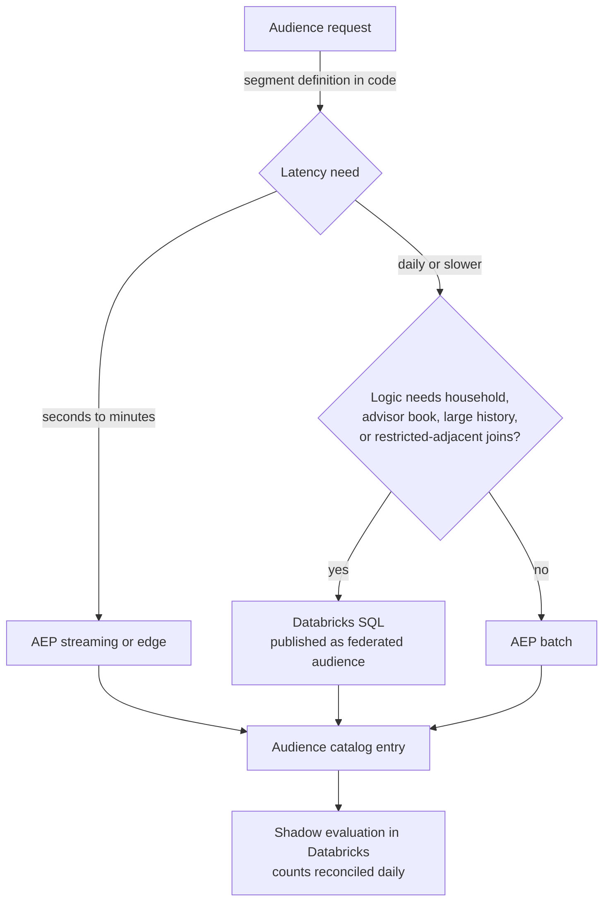
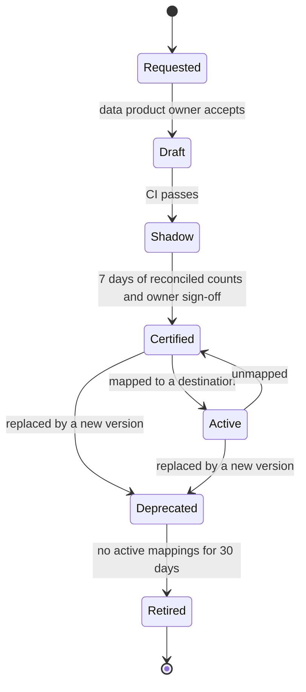

# Segmentation

## 1. Purpose

Make audiences certified, reusable data products instead of one-off queries. A marketer should be able to pick "new parents without term life, consented for email, not in an advisor's active pipeline" from a catalog, see its size and freshness, and send it to Marketo or Salesforce Marketing Cloud (SFMC) the same day.

## 2. Audience Types

| Type | Example | Typical home |
|---|---|---|
| Attribute | Policyholders aged 55 to 64 with a 401(k) rollover window | Adobe Experience Platform (AEP) batch |
| Behavioral | Started a term quote in the last 2 hours and did not finish | AEP streaming |
| Lifecycle | Day 30 after policy issue (onboarding) | AEP batch or journey entry |
| Model-driven | Top two deciles of annuity propensity (file 05) | AEP batch on a score attribute |
| Relationship | Households where any member holds group life through an employer but no member has individual life | Databricks, federated (Path B) |
| Advisor book | Clients of advisors in the Northeast region with no review in 18 months | Databricks, federated, to Marketo or customer relationship management (CRM) |
| Suppression | Deceased, legal hold, do-not-contact, recent complaint, open claim flag | Databricks, applied everywhere |
| Lookalike or seed | Paid media seed of recent issued-policy owners | AEP batch to paid destinations, or a clean room |

## 3. AEP Evaluation Methods

| Method | When it runs | Use for | Constraints |
|---|---|---|---|
| Batch | Daily schedule (or on demand) over the full profile store | Most marketing audiences | Up to a day of latency |
| Streaming | As events and attribute updates arrive | Abandon, trigger and service moments | Only streaming-eligible query patterns; keep logic simple **(verify current eligibility rules)** |
| Edge | On the Edge Network during the request | Same-page or next-page personalization | Narrow subset of streaming patterns; uses profile data projected to the edge |

Supporting features:

- **Computed attributes** roll recent events into profile attributes (for example `quote_starts_7d`), which turns many behavioral segments into simple attribute checks that qualify for streaming.
- **Externally generated audiences** let Databricks-built membership be imported, with labels and an expiry.
- **Federated Audience Composition** builds audiences from Databricks tables without copying the full dataset, and can enrich them with a few fields for personalization.

## 4. Where Each Audience Is Computed

**Shadow evaluation.** Every certified AEP audience also has a SQL twin evaluated in Databricks against the exported profile snapshot. If the two counts differ by more than 2% for two days in a row, the audience owner is alerted. This catches identity drift, late data and merge policy surprises before a marketer does.

## 5. Segments as Code

Each audience is a YAML file in a repo, reviewed like code. The full example is [examples/segment_definitions.yaml](./examples/segment_definitions.yaml). The fields that matter:

| Field | Why |
|---|---|
| `id`, `name`, `version` | Naming taxonomy and stable references from campaigns |
| `owner`, `steward` | Someone is accountable for correctness and retirement |
| `marketing_action` | Declared purpose, checked against data usage labels before publish |
| `compute_path` | `aep_streaming`, `aep_batch`, `aep_edge`, `federated`, `databricks_exception` |
| `logic.pql` or `logic.sql` | The definition; Profile Query Language (PQL) for AEP, SQL for Databricks |
| `requires_consent` | Channels the audience will be used on; enforced at activation, not baked into the logic |
| `suppressions` | References to shared suppression audiences, never copied logic |
| `expected_size` | Range used as a test; a size outside the range blocks promotion |
| `destinations` | Allowed destinations, so a consumer audience can't be mapped to an advisor channel by accident |
| `expires_on` | Forces review; campaign-specific audiences retire themselves |

### Continuous integration (CI) checks on every change

1. Schema validation of the YAML.
2. Label check: no field referenced by the logic carries a label that conflicts with `marketing_action` (file 07).
3. Compile: PQL validated through the Segmentation API in a dev sandbox; SQL compiled against Unity Catalog with the marketing service principal, so a reference to a restricted table fails at compile time.
4. Dry run: size computed in Databricks and compared with `expected_size`.
5. Diff report in the pull request: who enters, who leaves, compared with the current version.

### How Often Membership Refreshes

Deploying and refreshing are separate. The definition (the YAML file) changes only when a new version is merged, and `expires_on` forces a review before it lapses. The membership, meaning who is in the audience right now, is re-evaluated on the compute path's own schedule:

| Compute path | Membership refreshed | Typical use | Tradeoff |
|---|---|---|---|
| Federated (Databricks SQL read by FAC) | Daily, right after Gold is published (about 05:00). FAC re-runs the SQL and pulls the new EPID list | Household, advisor-book and heavy-join audiences | Up to a day stale |
| AEP batch | Daily, in AEP's batch segmentation run | Simple rules on profile attributes and scores | Up to a day stale |
| AEP streaming | Continuously. A person enters or leaves within minutes of the event that changes their status | Quote abandonment, just-applied suppression, event-triggered journeys | Limited logic, sandbox quotas, harder to test and audit |
| AEP edge | On every page request, at Adobe's Edge Network | Same-page or next-page web personalization | Most limited logic; sees only the profile slice copied to the Edge |

Sending follows the destination's schedule. A daily audience to SFMC is usually exported once a day after the refresh, and journeys pick up the new members.

### Downsides of Streaming and Edge Versus Batch

| Downside | What it means | How the design handles it |
|---|---|---|
| Limited logic | Only simple patterns: one event, or a short sequence within a time window, plus attributes already on the profile. No household or advisor joins, no heavy aggregations, short look-backs. Edge is the most limited, because it sees only the profile slice copied to the Edge | Precompute anything complex in the build path as a profile flag, then let the streaming rule test the flag |
| Quotas and cost | AEP caps how many streaming and edge segments a sandbox can have and how many events per second it evaluates. Real-time capacity is part of the license | Treat streaming slots as scarce; review them quarterly and retire unused ones |
| Harder to test and audit | Batch membership is a daily snapshot you can count, reconcile with the Databricks shadow copy and explain later. Streaming membership changes constantly | Export membership history to Bronze so "who was in it when we sent" can be answered |
| Noisy inputs | Late, duplicate or out-of-order events can qualify someone by mistake, for example a quote-abandon email to someone who finished on another device | Deduplicate by event ID, add a waiting window, and apply frequency caps and just-converted suppression |
| False freshness | A streaming rule that also uses a daily attribute, such as a nightly score, is only as fresh as that attribute | Document which inputs are daily in the segment file; don't promise real-time on them |

Rule of thumb: use streaming or edge only when acting within minutes changes the outcome, such as quote abandonment, a just-completed application or same-session web content. Everything else stays batch or federated, which is cheaper, easier to test and supports richer logic.

### Lifecycle

Ad hoc audiences built in the AEP UI are allowed in a sandbox and for one-off tests. They can be activated once with an expiry. If they are used a second time, they must be promoted to code.

## 6. Naming Taxonomy

`{audience_owner}_{purpose}_{line_of_business}_{descriptor}_v{n}`

| Part | Values |
|---|---|
| `audience_owner` | `cns` (consumer marketing), `adv` (advisor marketing), `wkp` (workplace or group), `svc` (servicing) |
| `purpose` | `acq`, `xsell`, `onb`, `ret`, `svc`, `sup` (suppression), `seed` |
| `line_of_business` | `life`, `annuity`, `retire`, `group`, `multi` |
| `descriptor` | short snake case |

Example: `cns_xsell_life_new_parents_v3`. The same key appears in the AEP audience name, the Marketo smart list or SFMC data extension name, and the campaign taxonomy (file 07), which is what lets measurement join them later.

## 7. Suppression Hierarchy

Suppressions are shared audiences applied in a fixed order. A campaign can add suppressions but cannot remove a higher-level one.

1. **Global hard stops:** deceased, legal hold, fraud flag, global do-not-contact.
2. **Regulatory:** channel opt-outs, Telephone Consumer Protection Act (TCPA) consent missing for calls or texts, state-specific restrictions.
3. **Customer care:** open complaint, open claim, recent bereavement. These are minimal yes or no flags produced inside the restricted zone. The detail never leaves it. Legal approves each flag's definition.
4. **Business:** in an advisor's active sales pipeline, contacted in the last N days (cross-channel frequency cap), employees and advisors for consumer offers.
5. **Campaign-specific:** holdout and control groups (file 07).

## 8. Example Audience Catalog (Enterprise)

| Audience | Path | Channel | Refresh |
|---|---|---|---|
| `cns_onb_multi_new_policy_day30_v1` | AEP batch | SFMC | Daily |
| `cns_acq_life_quote_abandon_2h_v2` | AEP streaming | SFMC, paid | Streaming |
| `cns_xsell_annuity_rollover_window_v1` | AEP batch on a model score | SFMC | Daily |
| `adv_svc_multi_no_review_18m_v1` | Federated from Databricks | Marketo, Salesforce tasks | Weekly |
| `wkp_xsell_life_group_only_households_v1` | Federated from Databricks | SFMC | Weekly |
| `cns_seed_life_issued_90d_v1` | AEP batch | Paid media | Weekly |
| `sup_global_hard_stops_v4` | Databricks, imported | All | Hourly |

## 9. Data Product Contract for an Audience

Each certified audience publishes:

- Membership table in `audiences.segment_membership` with `enterprise_person_id`, `audience_id`, `version`, `entered_at`, `exited_at`.
- Daily `audiences.audience_snapshot` for point-in-time analysis, so analysts can ask "who was in this audience on the day of the send".
- Freshness service level agreement (SLA), size, owner and a link to the YAML in the catalog.

That snapshot table is what makes audiences useful to analytics, not just to channels: it is the treatment definition for measurement and the population definition for models.

## 10. Interview Talk Track (2 minutes)

"I treat audiences as data products. Each one is a YAML file with an owner, a declared marketing purpose, its logic, expected size, allowed destinations and an expiry. CI checks the labels against the purpose and compiles the logic against Unity Catalog as the marketing principal, so a reference to a restricted table fails before anyone can activate it. Real-time moments like quote abandonment run as AEP streaming segments. Household and advisor-book logic runs in Databricks and comes in through Federated Audience Composition. Every AEP audience has a SQL twin in Databricks, and we alert when the counts drift more than 2%. That's how 'no prep required' stays true after launch, not just on day one."
