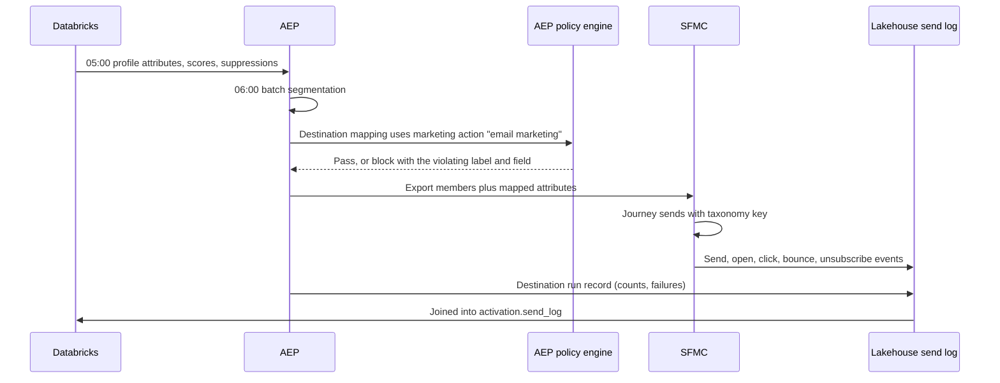
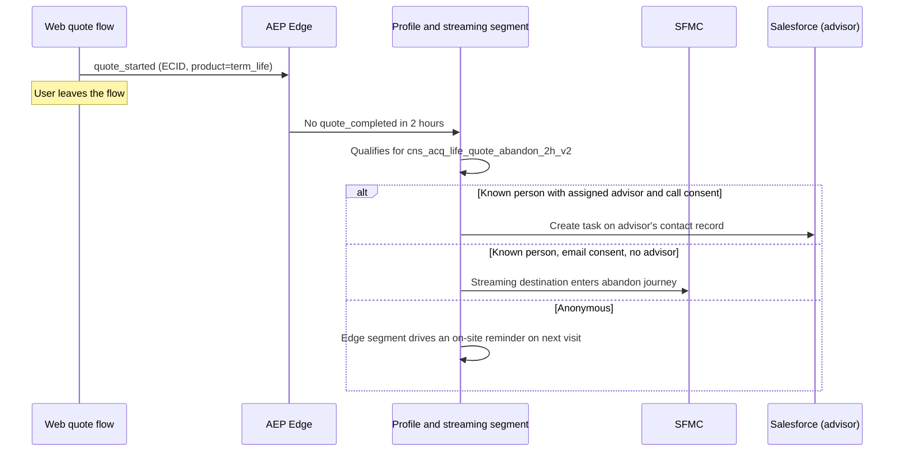
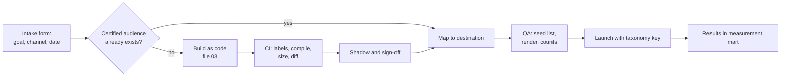

# Activation Workflows

## 1. Purpose

Get a certified audience, with the right attributes and the right consent, into the right channel, and record exactly who was sent what so the outcome can be measured. Activation is where governance becomes real: it is the last point where a bad decision can be stopped.

## 2. Destination Inventory (Enterprise)

| Destination | Connection | Identity sent | Use |
|---|---|---|---|
| Marketo Engage | Adobe Experience Platform (AEP) Marketo destination (person create or update, static list membership) | Email plus `EPID` as a custom field | Advisor programs, workplace and B2B-style nurture |
| Salesforce Marketing Cloud | AEP Salesforce Marketing Cloud (SFMC) destination (API) or file export to data extensions **(verify which the tenant licenses)** | Subscriber key = `EPID`, plus email and mobile | Consumer email, SMS, onboarding, cross-sell |
| Salesforce customer relationship management (CRM) | AEP Salesforce CRM destination or Databricks to CRM sync | `crm_contact_id` | Advisor tasks, lead creation, next best action on the record |
| Paid media | AEP destinations for major ad platforms | Hashed email or phone only | Acquisition, seed audiences, suppression of existing customers |
| Web personalization | Edge segments with Adobe Target or the site's decisioning | `ECID` | On-site offers |
| Cloud storage | AEP dataset or audience export | `EPID` | Direct mail vendor, analytics exports |
| Journey Optimizer (if licensed) | Native | `EPID` | Multi-step real-time journeys |

**SFMC subscriber key must be `EPID`, not email.** Email as the key means a changed email creates a new subscriber, splits history, and breaks unsubscribe enforcement. This is the most common SFMC design debt worth fixing during a migration.

## 3. Why Run Both Marketo and SFMC, and How to Keep Them Consistent

| | Marketo Engage | SFMC |
|---|---|---|
| Typical audience | Advisors, employers, plan sponsors, prospects in a considered B2B-style funnel | Consumers and policyholders at volume |
| Strengths | Lead scoring, Salesforce lead and contact sync, program-level attribution, account-based programs | High-volume send, SMS (MobileConnect), transactional messages, Journey Builder |
| Owner | Advisor or distribution marketing | Consumer marketing |

The rule: **audiences, taxonomy, consent and suppression are owned upstream; the platforms only execute.**

- No audience logic lives in Marketo smart lists or SFMC filters except program mechanics (for example "opened email 1, send email 2").
- One campaign taxonomy key (file 07) is required on every Marketo program and SFMC send.
- Global suppression and frequency caps are computed upstream across both platforms' send logs, so a person who is both a client and a workplace plan participant doesn't get mail from both teams in one week.
- Daily reconciliation compares Marketo list counts and SFMC data extension counts with AEP audience counts for each mapped destination.

### Channel Ownership Routing

When a person qualifies for both platforms, one owns the relationship for that purpose.

| Condition | Owner |
|---|---|
| Person is an advisor (has an `ADVISOR` row) | Marketo |
| Person is a contact at an employer or plan sponsor, for that purpose | Marketo |
| Person has an active advisor and the message is advisor-led | Marketo, with the advisor's branding, or a CRM task for the advisor |
| Everyone else, consumer purpose | SFMC |
| Transactional or servicing message | SFMC, not subject to marketing frequency caps, still subject to channel opt-outs where the law requires |

## 4. Core Workflows

### 4.1 Daily Batch Audience to SFMC

### 4.2 Quote Abandon: Streaming Trigger With Advisor Handoff

### 4.3 Advisor Book Program in Marketo

1. Databricks builds `adv_svc_multi_no_review_18m_v1` from holdings, advisor assignments and CRM activity.
2. The audience is federated into AEP and mapped to the Marketo destination with the advisor's ID as an attribute.
3. Marketo sends the advisor a digest ("12 clients due for a review") and, where the advisor has opted in, sends co-branded client emails.
4. Advisor actions (meeting booked, opportunity opened) flow back from Salesforce CDC to the lakehouse as outcomes.

### 4.4 Activation Request Workflow (People Process)

Service levels: reuse of a certified audience is same day. A new audience is 3 to 5 business days, most of which is shadow time. That expectation is published so "urgent" is planned against a known clock.

## 5. Policy and Consent Gates

There are three gates, and activation must pass all of them.

| Gate | Where | Fails when |
|---|---|---|
| Data usage | AEP policy engine at destination mapping and at each run | A mapped or segment-referenced field carries a label whose policy forbids the destination's marketing action |
| Consent | AEP consent policies on the profile, evaluated at export time | The person has not consented for that channel and purpose, or has revoked consent |
| Destination allow-list | Segment YAML `destinations` field, checked at mapping | An audience is mapped to a destination it was not certified for |

For the exception path (Databricks direct to a non-AEP target), a **policy check service** applies the same rules. It reads Unity Catalog tags, the label-to-policy table and the consent table, and returns allow or deny with reasons. The export job cannot write a file without an allow token, and the token ID is stored on the send log.

## 6. Identity Per Destination

| Destination | Key | Rules |
|---|---|---|
| SFMC | `EPID` as subscriber key | Email and mobile as attributes, refreshed on change |
| Marketo | Email (Marketo's dedupe key) | `EPID` in a custom field; nightly check for duplicate Marketo persons sharing an `EPID` |
| Salesforce | `crm_contact_id` | The identity spine pushes merges as tasks; it never merges CRM records itself |
| Paid media | SHA-256 email and phone | Minimum audience size before export; no sensitive-category audiences |
| Edge | `ECID` | Only edge-safe attributes projected |

## 7. Failure Modes

| Failure | Detection | Response |
|---|---|---|
| Destination rate limit or outage | Destination run status and failed-record count | Automatic retry; alert when failed share is over 1% |
| Partial export | Run counts compared with audience size | Block the send in the journey until counts reconcile |
| ID merge between build and send | `id_change` events | Recompute membership for affected IDs; dedupe at the channel |
| Consent revoked after export | Consent change stream | Push suppression to the channel within the regulatory window; channels also check their own unsubscribe lists |
| Audience size spike | Size outside `expected_size` | Pause mapping and page the owner |

## 8. Monitoring

Every destination run writes a record with audience ID and version, destination, start and end, members exported, failures, policy decision and taxonomy key. Dashboards show freshness against service level agreement (SLA), failure rates, blocks by policy, and daily count reconciliation by destination.

## 9. Interview Talk Track (2 minutes)

"Activation has one rule: audiences, consent and taxonomy are owned upstream, and Marketo and SFMC only execute. Marketo owns advisors and employer contacts, SFMC owns consumers, and a routing table decides who owns a person who qualifies for both. Every destination mapping goes through three gates: data usage labels against the marketing action, consent evaluated at export, and an allow-list of destinations per audience. The one path that skips AEP, Databricks to a mail vendor, calls a policy check service that returns an allow token, and no file is written without it. Every run writes a send log with the taxonomy key, and that's what lets us join a policy issued six weeks later back to the touch."
