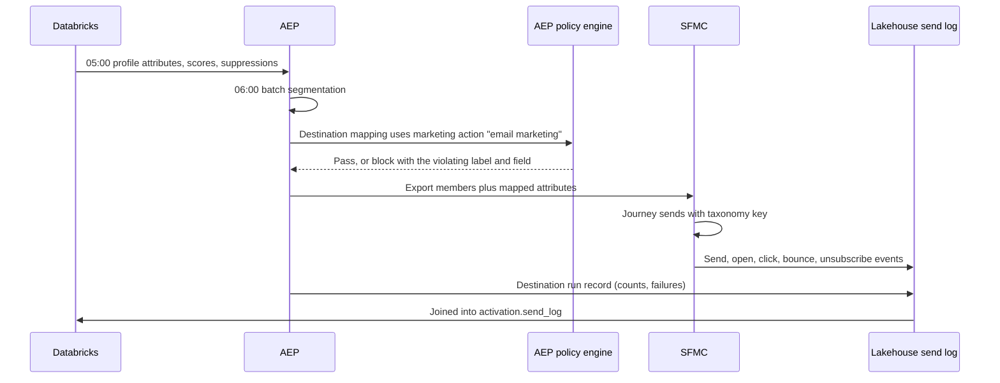
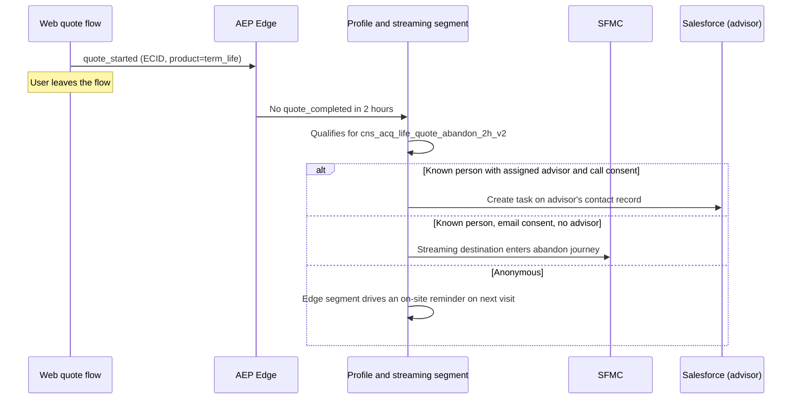
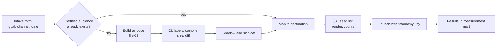

# Activation Workflows

## 1. Purpose

Get a certified audience, with the right attributes and the right consent, into the right channel, and record exactly who was sent what so the outcome can be measured. Activation is where governance becomes real: it is the last point where a bad decision can be stopped.

## 1.1 How Activation Works, Step by Step

A segment says who is in the audience. Activation turns that list into a message and records what happened. In AEP it runs as a **destination dataflow**, which is a saved connection from one audience to one channel, with a field mapping and a schedule. The example follows Jane Doe (`p42`) from `wkp_xsell_life_group_only_households_v1` to an SFMC email.

| Step | Where | What happens |
|---|---|---|
| 1. Membership | Databricks, then AEP | The segment run writes `p42 · wkp_xsell_life_group_only_households_v1 · realized · 2026-10-26`. Leavers are written as `exited` |
| 2. Dataflow, set up once | AEP Destinations | The audience is connected to `sfmc_consumer`, given a field mapping and a schedule. The three gates (section 5) check this step |
| 3. Scheduled run | AEP | At 06:00 the dataflow picks up new and exited members, drops anyone whose consent fails for this channel, and sends the rest |
| 4. Delivery | SFMC | Each member lands as a row in the audience's data extension |
| 5. Journey | SFMC Journey Builder | The data extension is the journey's entry source, so new rows get email 1. Every send carries the `campaign_key` |
| 6. Feedback | Lakehouse | SFMC engagement events and AEP's run record land in `activation.send_log` |
| 7. Exit | AEP, then SFMC | When p42 buys individual life, the next run sends `exited`, and the journey's exit rule removes p42 before email 2 |

```yaml
# Step 2: destination dataflow
dataflow: wkp_xsell_life_to_sfmc
audience: wkp_xsell_life_group_only_households_v1
destination: sfmc_consumer
marketing_action: email_marketing
schedule: daily 06:00 ET
mapping:                              # AEP profile field -> SFMC field
  identityMap.EPID:   SubscriberKey
  person.email:       EmailAddress
  person.first_name:  FirstName
  advisor.name:       AdvisorName
  audience.status:    AudienceStatus  # realized or exited
campaign_key: WKP-XSELL-LIFE-FY27-Q4-EM
```

```text
# Step 4: row in the SFMC data extension
SubscriberKey  EmailAddress          FirstName  AdvisorName  AudienceStatus  ExportedAt
p42            jane.doe@example.com  Jane       R. Patel     realized        2026-10-26T06:04Z

# Step 6: rows in activation.send_log
epid  campaign_key               channel  event  event_ts           run_id
p42   WKP-XSELL-LIFE-FY27-Q4-EM  email    sent   2026-10-26T09:00Z  run_8812
p42   WKP-XSELL-LIFE-FY27-Q4-EM  email    click  2026-10-26T12:42Z  run_8812
--    run_8812 summary: exported 48,210 · dropped for consent 312 · failed 0
```

Streaming activation follows the same steps, with two differences. Membership changes are sent within minutes, and the channel step is usually a single trigger, such as a journey entry or a CRM task (section 4.2).

### The Channel Table as a Change Queue

The SFMC data extension or Marketo static list is not a true change data capture (CDC) log. It is an upsert table: one row per person holding their latest status (`realized` or `exited`). The channel tool treats new and changed rows as its queue. What differs between the modes is when rows are written and how the channel notices them. The walkthrough page animates each mode step by step.

| | Batch | Streaming | Edge |
|---|---|---|---|
| Who writes the table | AEP batch dataflow | AEP streaming destination | No table |
| When | Once per scheduled run, such as 06:00 | Within minutes of qualifying, one person at a time | Not applicable: the decision comes back in the page response |
| What is written | Only changes since the last run: new rows `realized`, leavers flipped to `exited` | The same, as each change happens | Membership stays on the edge profile |
| SFMC reads it with | Journey entry source on the data extension, evaluated for new records on a schedule | Journey entry source that admits new rows as they arrive | Not used |
| Marketo reads it with | Batch smart campaign on "Member of List" | Trigger campaign on "Added to List" | Not used |
| Exit | `exited` row: SFMC exit criteria, or Marketo "Removed from List" | Same, within minutes | The next request simply doesn't qualify |

## 2. Destination Inventory (Enterprise)

| Destination | Connection | Identity sent | Use |
|---|---|---|---|
| Marketo Engage | Adobe Experience Platform (AEP) Marketo destination (person create or update, static list membership) | Email plus `EPID` as a custom field | Advisor programs, workplace and B2B-style nurture |
| Salesforce Marketing Cloud | AEP Salesforce Marketing Cloud (SFMC) destination (API) or file export to data extensions **(verify which the tenant licenses)** | Subscriber key = `EPID`, plus email and mobile | Consumer email, SMS, onboarding, cross-sell |
| Salesforce customer relationship management (CRM) | AEP Salesforce CRM destination or Databricks to CRM sync | `crm_contact_id` | Advisor tasks, lead creation, next best action on the record |
| Paid media | AEP destinations for major ad platforms | Hashed email or phone only | Acquisition, seed audiences, suppression of existing customers |
| Web personalization | Edge segments with Adobe Target or the site's decisioning | `ECID` | On-site offers |
| Cloud storage | AEP dataset or audience export | `EPID` | Direct mail vendor, analytics exports |
| Journey Optimizer (if licensed) | Native | `EPID` | Multi-step real-time journeys |

**SFMC subscriber key must be `EPID`, not email.** Email as the key means a changed email creates a new subscriber, splits history, and breaks unsubscribe enforcement. This is the most common SFMC design debt worth fixing during a migration.

## 3. Why Run Both Marketo and SFMC, and How to Keep Them Consistent

| | Marketo Engage | SFMC |
|---|---|---|
| What it is | Marketing automation software built for business-to-business (B2B) marketing: Prudential uses it to market to other businesses and their people (advisors, partner firms, employers) | Marketing software built for business-to-consumer (B2C) messaging at high volume: Prudential uses it to reach individual customers and prospects |
| Who it talks to here | Advisors, employers, plan sponsors and prospects in a long sales funnel | Consumers and policyholders at volume |
| Typical programs | Advisor recruiting and enablement, employer benefit programs, lead nurture, webinars | Onboarding, cross-sell, policy anniversary, quote-abandon follow-up, billing and servicing notices |
| Strengths | Lead scoring, two-way Salesforce lead and contact sync, account-based programs, program-level attribution | Very high send volume, SMS, transactional messages, Journey Builder multi-step journeys |
| Record key | Marketo lead ID, synced to the Salesforce lead or contact | Subscriber key = EPID, never the email address |
| Link to Salesforce CRM | Native sync: hands warm leads to advisors and sales as CRM leads or tasks | Marketing Cloud Connect: reads CRM data and logs sends back to the contact |
| Owned by | Advisor and distribution marketing | Consumer marketing |

The rule: **audiences, taxonomy, consent and suppression are owned upstream; the platforms only execute.**

- No audience logic lives in Marketo smart lists or SFMC filters except program mechanics (for example "opened email 1, send email 2").
- One campaign taxonomy key (file 07) is required on every Marketo program and SFMC send.
- Global suppression and frequency caps are computed upstream across both platforms' send logs, so a person who is both a client and a workplace plan participant doesn't get mail from both teams in one week.
- Daily reconciliation compares Marketo list counts and SFMC data extension counts with AEP audience counts for each mapped destination.

### Channel Ownership Routing

When a person qualifies for both platforms, one owns the relationship for that purpose.

| Condition | Owner |
|---|---|
| Person is an advisor (has an `ADVISOR` row) | Marketo |
| Person is a contact at an employer or plan sponsor, for that purpose | Marketo |
| Person has an active advisor and the message is advisor-led | Marketo, with the advisor's branding, or a CRM task for the advisor |
| Everyone else, consumer purpose | SFMC |
| Transactional or servicing message | SFMC, not subject to marketing frequency caps, still subject to channel opt-outs where the law requires |

## 4. Core Workflows

### 4.1 Daily Batch Audience to SFMC



### 4.1a Scheduled Personalized Sends at Scale

Example: the workplace cross-sell email to about 42,000 people every Tuesday at 09:00 local time, each with a different offer, image and advisor. Decide everything per person in Databricks; SFMC only fills the template.

**One row per person, decided upstream:**

```sql
-- activation.send_ready_wkp_life  (Gold, built 05:20, one row per person)
enterprise_person_id  p42
email                 jane.doe@example.com          -- I1
first_name            Jane                          -- I1
offer_code            TERM_GAP_500K                 -- from next best action ranking
content_variant       young_family                  -- picks hero image and copy
advisor_name          R. Patel                      -- null: show the 1-800 line instead
advisor_phone         +1 973 555 0142
coverage_gap_band     250k-500k                     -- GLBA_NPI
send_local_time       09:00
send_tz               America/New_York
holdout               false
campaign_key          fy27-wkp-life-xsell-email-wkp_xsell_life_group_only_households_v1-c021
```

**The schedule:**

| Time (ET) | Where | What happens | Check or output |
|---|---|---|---|
| 04:45 | Databricks | Gold profile, scores and suppressions refreshed; `contact_eligibility` rebuilt from the send log | Freshness check passes. `p42 capped_until 10-29 09:10` |
| 05:00 | Databricks to AEP | **Batch 1, profile load:** facts about each person, upserted onto the AEP profile | `p42 annuity_propensity=0.71 assigned_advisor=null last_mkt_email_at=10-26 09:10` |
| 05:20 | Databricks | Next best action picks one offer per person; frequency cap and holdout applied; `send_ready` table built | 46,870 eligible; 4,690 (10%) held out and logged; 42,180 rows to send |
| 05:30 | Databricks to AEP | **Batch 2, audience load:** who is in this campaign's audience, sent as a list (Federated Audience Composition or audience import) | `p55 cns_xsell_annuity_rollover_window_v1 existing`; 42,180 members |
| 06:00 | AEP | **Batch 3, AEP batch segmentation:** AEP evaluates its own segment rules against the profiles loaded at 05:00. This campaign's audience was built in Databricks, so it passes through unchanged; rule-based audiences for other campaigns refresh here | Segment memberships updated on each profile |
| 06:00 | AEP | Destination dataflow runs the three gates (labels, consent, allow-list) | 1,204 dropped on consent; 40,976 to export |
| 06:30 | AEP to SFMC | File export: CSV to SFMC SFTP, Automation Studio imports it into the data extension | 40,976 rows loaded; count matches within 1% |
| 08:30 | SFMC | Pre-send checks: seed list proofs for each content variant, count against expected size, frequency cap | Pass. A miss pauses the send and pages the owner |
| 09:00 local | SFMC | Journey sends at 09:00 in each time zone, throttled per hour | Eastern first, Pacific three hours later |
| Through the day | SFMC to Bronze | Send, open, click, bounce and unsubscribe events flow back | Joined into `send_log` by `campaign_key` |

**The template only fills slots (AMPscript):**

```text
%%[
SET @offer   = AttributeValue("offer_code")
SET @advisor = AttributeValue("advisor_name")
]%%
Hi %%=ProperCase(AttributeValue("first_name"))=%%,
%%=ContentBlockByKey(Concat("offer_", @offer))=%%
%%[ IF NOT Empty(@advisor) THEN ]%%
  Your advisor %%=v(@advisor)=%% can walk you through it: %%=AttributeValue("advisor_phone")=%%
%%[ ELSE ]%%
  Call us at 1-800-555-0100.
%%[ ENDIF ]%%
```

Marketo does the same with tokens such as `{{lead.Offer Code}}` and dynamic content by segment, from a scheduled batch campaign; it suits the smaller advisor and employer programs.

**What keeps it safe at this volume:**[^send-once]

| Rule | How |
|---|---|
| Decide upstream, render in the channel | Databricks picks the offer, variant and advisor per person. SFMC only fills slots. No business logic in the template |
| Bulk moves as a file | Tens of thousands of rows go as a file import, not record-by-record API calls, which are slower and rate limited. Verify the export options your AEP license includes |
| Count reconciliation | Rows exported, rows loaded and rows sent must agree within 1%, or the send pauses |
| Consent twice | Checked by AEP at export and by SFMC at send, so an opt-out after 06:30 still wins |
| Frequency cap | One marketing email per person per 72 hours across all programs. Enforced in Databricks when the audience is built (05:20): a `contact_eligibility` table reads the Gold send log, which holds both SFMC and Marketo sends, and anyone emailed in the last 72 hours is left out before AEP sees the audience. Streaming triggers check the same rule through a `last_mkt_email_at` profile attribute [^freq-cap] |
| Holdout | 10% randomly held back and logged, so uplift can be measured |
| Kill switch | Owner can pause the journey; the reason and counts go on the send log |

[^send-once]: **Who makes sure each person gets one email?** SFMC and AEP run their own send workers internally; you configure them, you don't build them. The data extension key is the EPID, the journey blocks re-entry, and one scheduled run per campaign is the authority for that run. You own a send ledger keyed by `send_key = hash(EPID, campaign_key, send_date)`; a key already in the send log is skipped. Delivery is at least once, made effectively once by that key. Workers and leases are only needed if your own code sends (for example direct email API calls). Then each ledger row is a lease (`status=leased, lease_owner=worker-07, lease_expires=09:02:30, attempt=1`) claimed with a conditional update (Postgres `SKIP LOCKED`, a DynamoDB conditional write or a Delta `MERGE`); the key is passed to the provider as its idempotency key, and an expired lease lets another worker retry without a duplicate. No consensus protocol is needed, only one strongly consistent store with compare-and-set.

[^freq-cap]: **Where the frequency cap is enforced.** Not in AEP, SFMC or Marketo, because none of them sees the other's sends. Databricks rebuilds `activation.contact_eligibility` from `activation.send_log` every morning before audiences are built:

    ```
    epid  last_mkt_email_at  last_program               capped_until      email_today_winner
    p42   2026-10-26 09:10   Marketo workplace nurture  2026-10-29 09:10  none
    p55   2026-10-21 08:45   SFMC annuity xsell         not capped        cns_xsell_annuity_rollover_window_v1
    ```

    Audiences built in Databricks join it with `WHERE capped_until < send_time`, so p42 is not exported today. Audiences AEP builds from its own rules read the same value as `last_mkt_email_at`, sent in the daily profile load (05:00, attributes per person). That load is separate from the audience load (05:00, who is in which audience) and from AEP's own batch segmentation (06:00). When two campaigns want the same person on the same day, the higher priority one (or the next best action pick) wins and the other excludes them. For streaming triggers, `last_mkt_email_at` is loaded to the AEP profile and the streaming segment rule includes "last marketing email more than 72 hours ago". That attribute refreshes in batch, so a send earlier the same day can slip through; if that matters, the journey adds a decision split against an hourly cap data extension. Transactional and servicing messages are exempt.

### 4.2 Quote Abandon: Streaming Trigger With Advisor Handoff



### 4.3 Advisor Book Program in Marketo

1. Databricks builds `adv_svc_multi_no_review_18m_v1` from holdings, advisor assignments and CRM activity.
2. The audience is federated into AEP and mapped to the Marketo destination with the advisor's ID as an attribute.
3. Marketo sends the advisor a digest ("12 clients due for a review") and, where the advisor has opted in, sends co-branded client emails.
4. Advisor actions (meeting booked, opportunity opened) flow back from Salesforce CDC to the lakehouse as outcomes.

### 4.4 Activation Request Workflow (People Process)



Service levels: reuse of a certified audience is same day. A new audience is 3 to 5 business days, most of which is shadow time. That expectation is published so "urgent" is planned against a known clock.

## 5. Policy and Consent Gates

There are three gates, and activation must pass all of them.

| Gate | Where | Fails when |
|---|---|---|
| Data usage | AEP policy engine at destination mapping and at each run | A mapped or segment-referenced field carries a label whose policy forbids the destination's marketing action |
| Consent | AEP consent policies on the profile, evaluated at export time | The person has not consented for that channel and purpose, or has revoked consent |
| Destination allow-list | Segment YAML `destinations` field, checked at mapping | An audience is mapped to a destination it was not certified for |

For the exception path (Databricks direct to a non-AEP target), a **policy check service** applies the same rules. It reads Unity Catalog tags, the label-to-policy table and the consent table, and returns allow or deny with reasons. The export job cannot write a file without an allow token, and the token ID is stored on the send log.

## 6. Identity Per Destination

| Destination | Key | Rules |
|---|---|---|
| SFMC | `EPID` as subscriber key | Email and mobile as attributes, refreshed on change |
| Marketo | Email (Marketo's dedupe key) | `EPID` in a custom field; nightly check for duplicate Marketo persons sharing an `EPID` |
| Salesforce | `crm_contact_id` | The identity spine pushes merges as tasks; it never merges CRM records itself |
| Paid media | SHA-256 email and phone | Minimum audience size before export; no sensitive-category audiences |
| Edge | `ECID` | Only edge-safe attributes projected |

## 7. Failure Modes

| Failure | Detection | Response |
|---|---|---|
| Destination rate limit or outage | Destination run status and failed-record count | Automatic retry; alert when failed share is over 1% |
| Partial export | Run counts compared with audience size | Block the send in the journey until counts reconcile |
| ID merge between build and send | `id_change` events | Recompute membership for affected IDs; dedupe at the channel |
| Consent revoked after export | Consent change stream | Push suppression to the channel within the regulatory window; channels also check their own unsubscribe lists |
| Audience size spike | Size outside `expected_size` | Pause mapping and page the owner |

## 8. Monitoring

Every destination run writes a record with audience ID and version, destination, start and end, members exported, failures, policy decision and taxonomy key. Dashboards show freshness against service level agreement (SLA), failure rates, blocks by policy, and daily count reconciliation by destination.

## 9. Interview Talk Track (2 minutes)

"Activation has one rule: audiences, consent and taxonomy are owned upstream, and Marketo and SFMC only execute. Marketo owns advisors and employer contacts, SFMC owns consumers, and a routing table decides who owns a person who qualifies for both. Every destination mapping goes through three gates: data usage labels against the marketing action, consent evaluated at export, and an allow-list of destinations per audience. The one path that skips AEP, Databricks to a mail vendor, calls a policy check service that returns an allow token, and no file is written without it. Every run writes a send log with the taxonomy key, and that's what lets us join a policy issued six weeks later back to the touch."
