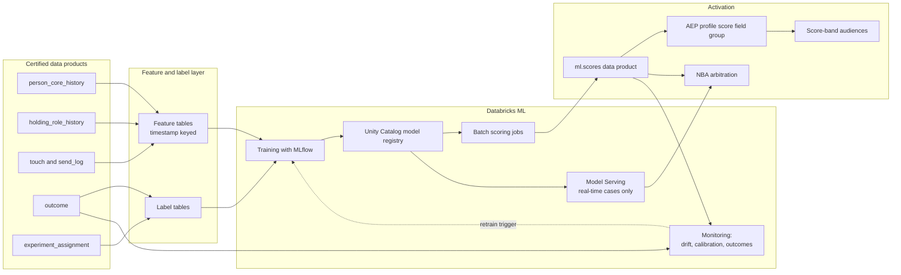

# ML and Analytics Data Products

## 1. Purpose and Stance

This file covers two things an analytics leader will probe:

1. **How analytics and data science teams actually consume data products**, and what the data products team owes them.
2. **The model portfolio** a marketing analytics team at an insurer needs, and how each model gets from a notebook into a channel.

Platform stance:

- **Custom ML lives in Databricks.** Features in Unity Catalog, training and tracking in MLflow, models registered in Unity Catalog, batch scoring as jobs, and Model Serving for the few real-time cases.
- **AEP is the activation surface for scores**, not the place models are built. AEP Data Science Workspace is no longer available for purchase. Customer AI (a packaged propensity service in Real-Time CDP, where licensed) is useful as a fast baseline for event-driven propensity, and AI Assistant can draft audiences, but neither replaces a governed model portfolio.
- **Scores are data products.** A score table has an owner, a contract, a freshness SLA and a model card, the same as any certified dataset.

## 2. How Analytics Teams Consume Data Products

### 2.1 What analysts and data scientists actually do with the data

| Workflow | What they need | Failure that wastes their week |
|---|---|---|
| Explore a question ("did the rollover campaign work?") | Joined touches, outcomes and audiences at person grain, with stable IDs | Rebuilding the join from raw send logs and three ID types |
| Build a model | Point-in-time features, a clean label table, the population definition | Leakage from features computed after the label date |
| Run an experiment | Randomized assignment recorded before treatment, exposure log, outcome table | Holdouts that leaked into the treated audience |
| Measure a channel (MMM) | Weekly spend, impressions, outcomes and controls by geo and channel | Spend in finance's chart of accounts that doesn't map to the campaign taxonomy |
| Report | Certified metrics with one definition | Two "conversion rate" numbers in two dashboards |
| Monitor a model | Scores, outcomes and population drift over time | Outcomes that arrive 8 weeks later with no join key |

### 2.2 The Analytics Data Product Set

These are the certified tables the data products team publishes for analytics. Each one has a contract (section 2.3).

| Data product | Grain | Point-in-time? | Primary consumers |
|---|---|---|---|
| `profile.person_core_history` | Person by effective date (SCD type 2) | Yes | Every model, every analysis |
| `profile.holding_role_history` | Person, holding, role by effective date | Yes | Cross-sell, lapse, CLV |
| `profile.relationship` and `profile.household` | Edge or member by effective date | Yes | Household models, advisor models |
| `profile.advisor_assignment_history` | Person, advisor by effective date | Yes | Advisor models, confounding control |
| `features.*` | Entity by `as_of` timestamp | Yes, by design | Model training and scoring |
| `ml.labels_*` | Entity, observation date, label window | Yes | Model training |
| `activation.send_log` and `measurement.touch` | One row per message, impression or call | Event time | Attribution, experiments, fatigue models |
| `measurement.outcome` | One row per lead, application, issue, lapse, with dates and premium | Event time | Every outcome-based model and report |
| `measurement.experiment_assignment` | Person, experiment, arm, assigned_at | Assignment time | Incrementality, uplift models |
| `audiences.audience_snapshot` | Person, audience, date | Daily | Treatment definitions, populations |
| `measurement.media_weekly` | Week, geo, channel, campaign key, spend, impressions | Weekly | MMM |
| `ml.scores` | Person, model, version, scored_at | Yes | Activation, monitoring, analysis |

### 2.3 Contract Every Analytics Data Product Carries

- Grain and primary key, stated in one line.
- Time semantics: event time, effective-dated, or snapshot, plus how late data is handled.
- Freshness SLA and completeness SLA (for example, "outcomes for the prior day complete by 08:00; policy issue events can arrive up to 45 days late and are restated").
- Known gaps and biases (for example "advisor-sourced applications before 2024 lack campaign keys").
- Usage labels per column (file 07), so a data scientist knows before building a feature whether the resulting score can be activated.
- Owner, steward and a changelog. Breaking changes need a new version and a deprecation window.

### 2.4 Point-in-Time Correctness

Leakage is the most common reason a marketing model looks great offline and fails in market. The platform prevents it, rather than trusting each modeler.

- Feature tables are Unity Catalog feature tables with a timestamp key. Training sets are built with point-in-time lookups against a spine of `(entity_id, observation_ts)`.
- Label tables are defined with an explicit observation date and label window, for example "applied for any annuity within 90 days after `observation_ts`".
- History tables are effective-dated, so "was this person a policyholder on that date?" has one answer.
- This repo already follows the pattern in [config/features/offline_feature_defs.yaml](../../config/features/offline_feature_defs.yaml) and [dbt/models/features](../../dbt/models/features), where each feature set declares its entity, window and label source.

### 2.5 Peer Contract With Analytics

| Data products team owes analytics | Analytics owes the data products team |
|---|---|
| Stable person IDs with merge and split events | Feedback on gaps and bad joins as issues, not side spreadsheets |
| Effective-dated history and point-in-time features | Promotion of reusable features and labels back into shared tables |
| Outcome and touch tables with taxonomy keys | Model cards, monitoring and retirement for models they own |
| Experiment assignment infrastructure | Experiment designs and power calculations before launch |
| Certified metric definitions in the semantic layer | Agreement on one definition per metric before it ships to a dashboard |
| Score publication and activation path | Business validation that a score is ready to drive spend |

Adoption is measured on both sides: number of models and analyses built on certified tables, time from question to first query, and share of dashboards on certified metrics.

## 3. Architecture

### Score Contract

The full shape is in [examples/score_contract.yaml](./examples/score_contract.yaml). In short:

- `ml.scores`: `enterprise_person_id`, `model_name`, `model_version`, `score`, `decile`, `reason_codes`, `scored_at`, `valid_until`, `population_flag`.
- In AEP, scores land in a tenant field group (for example `_tenant.scores.annuityPropensity.decile`). Only the decile and reason code family are sent when the raw score isn't needed, which reduces what a channel can see.
- Scores inherit the strictest usage label of their inputs. If a model used a field labeled "no marketing", its score cannot be activated, and CI on the score table catches this.

## 4. Model Portfolio

The portfolio is grouped by the question each model answers. "First wave" marks the models to build in the first two quarters.

### 4.1 Summary

| # | Model | Business question | Main consumer | Wave |
|---|---|---|---|---|
| 1 | Cross-sell propensity, per product | Who is likely to buy product X in the next 90 days? | Consumer marketing, advisors | First |
| 2 | Lead scoring (prospects and inbound leads) | Which leads should an advisor call first? | Advisor marketing, distribution | First |
| 3 | Lapse and surrender risk | Which in-force policies are at risk, so service can intervene? | Servicing, retention | First |
| 4 | Customer lifetime value | What is a person or household worth over time? | Prioritization, bidding, NBA | Second |
| 5 | Next best action arbitration | Of all eligible actions, which one now, in which channel? | All channels | Second |
| 6 | Uplift (persuadability) | Who changes behavior because we contacted them? | Budget allocation | Second |
| 7 | Life-event detection | Who just had a baby, bought a home, changed jobs or neared retirement? | Triggers | Second |
| 8 | Channel, timing and fatigue | Which channel and send time, and when to stop? | SFMC and Marketo operations | Second |
| 9 | Advisor-lead matching and advisor health | Which advisor should get this lead? Which advisors are at risk of disengaging? | Distribution | Second |
| 10 | Marketing mix model | How much did each channel contribute, and where should the next dollar go? | CMO, finance, analytics | First (a version exists in most firms; recalibrate) |
| 11 | Multi-touch attribution and conversion lag | Which touches get credit for a policy issued weeks later? | Channel owners | Second |
| 12 | Lookalike and acquisition propensity | Who outside the base looks like our best new customers? | Paid media | Third |
| 13 | Operational ML | Probabilistic identity matching, data quality anomalies, volume forecasting | Data platform, advisor capacity | Ongoing |
| 14 | Generative AI | Content variants, advisor note summarization, natural-language audience drafts | Marketing ops, advisors | Pilot with guardrails |

### 4.2 Model Details

**1. Cross-sell propensity (per product).**
- Label: applied for product X within 90 days of `observation_ts`. Use application submitted rather than policy issued, because issue lags by weeks and depends on underwriting, which marketing must not model.
- Population: active customers without product X, eligible by age and state.
- Features: holdings and tenure, household composition, life-stage signals, digital engagement (`quote_starts_30d`, product page views), advisor relationship, prior campaign exposure.
- Method: gradient-boosted trees per product with calibrated probabilities. Start with one multi-product model with a product feature only if per-product data is thin.
- Evaluation: AUC and lift in the top two deciles on out-of-time validation; then a randomized holdout in market.
- Activation: decile to the AEP profile, score-band audiences, and an NBA input.

**2. Lead scoring.**
- Label: lead converts to submitted application within 60 days.
- Features: source, form fields, firmographic data for workplace leads, engagement, time to first advisor touch.
- Note: advisor follow-up is itself a treatment. Control for it, or the model learns "leads advisors liked convert".
- Activation: score on the lead in Salesforce and Marketo; routing (model 9).

**3. Lapse and surrender risk.**
- Label: lapse, surrender or non-payment within 90 days.
- Features: payment behavior, premium changes, policy age, servicing contacts, digital disengagement, advisor departure.
- Governance: it uses in-force servicing data. Legal must confirm the purpose (retention servicing) and the channels it may drive. The output feeds service outreach and advisor tasks, not acquisition offers.
- Evaluation: precision at the capacity the service team can call, plus an in-market save rate against a holdout.

**4. Customer lifetime value.**
- Approach: persistency-adjusted expected premium or margin over a horizon. Combine a survival model for persistency with expected premium by product, at person and household grain.
- Use: value weighting in NBA, media bidding caps, advisor prioritization.
- Note: finance owns the margin assumptions. Analytics owns the model. Agree the definition once.

**5. Next best action arbitration.**
- Not one model, but a decision layer: `expected_value = P(response | action) × value(action) × eligibility × (1 − fatigue_penalty)`, subject to business rules, consent and contact policy.
- Inputs: models 1, 3, 4, 6 and 8, plus eligibility rules and the suppression hierarchy (file 03).
- Runs as a batch daily ranking per person into `ml.nba_ranked_actions`. Run it in real time via Model Serving only for the web or call center moment.
- Delivery: top action to AEP for channels; top three to the advisor's CRM view with reason codes.

**6. Uplift.**
- Question: who responds *because* of the contact? This avoids spending on people who would buy anyway and annoying people who react badly.
- Method: two-model or X-learner meta-learners, or causal forests, trained on randomized holdout data.
- Requirement: an experiment assignment table and persistent holdouts. Without randomized data, do not ship an uplift model.

**7. Life-event detection.**
- Signals: address change (home purchase), dependent added to group benefits, beneficiary change, retirement-age windows, job-change signals from workplace data, site content consumption.
- Method: rules first, then a classifier where signals are noisy.
- Output: event records (`life_event`, `detected_at`, `confidence`), which drive journeys more often than scores do.

**8. Channel, send time and fatigue.**
- Channel preference: multinomial model on historic response by channel.
- Send time: per-person best hour, with a fallback by segment.
- Fatigue: response decay as a function of recent touch count. It sets the cross-channel frequency cap per person instead of one global number.

**9. Advisor-side models.**
- Lead to advisor matching: probability of conversion given lead and advisor features (specialty, licensing by state, capacity, past conversion on similar leads), subject to fairness and capacity rules.
- Advisor health: risk of an advisor disengaging, using production trends and platform usage. It is a distribution analytics product that marketing can support.
- Book at-risk: clients of an advisor who left. These are routed to a retention program quickly.

**10. Marketing mix model.**
- Weekly by geo and channel, with spend, impressions, outcomes (applications, issued premium) and controls (seasonality, rates, competitor activity, macro).
- Method: Bayesian MMM with adstock and saturation (for example open-source Meridian or PyMC-Marketing), calibrated with experiment results as priors.
- Insurance specifics: long lag from spend to issued policy, so model applications and use a lag distribution for issued premium. Advisor-driven sales need distribution activity as a control.
- Data product: `measurement.media_weekly`, built from the campaign taxonomy so spend maps to channels without manual reclassification.

**11. Multi-touch attribution and conversion lag.**
- Data-driven attribution (Markov removal effect or Shapley) on person-level touch paths for digital and owned channels, where the identity spine makes paths joinable.
- A conversion lag model (time from first touch to application and to issue) sets how long a campaign's results stay open, and corrects early reads of recent campaigns.
- Attribution is for in-channel optimization. Budget decisions use MMM and experiments. Say that explicitly; analytics directors look for it.

**12. Lookalike and acquisition propensity.**
- Seeds from recent high-value issued customers, sent to ad platforms as hashed identifiers, or modeled in a clean room.
- Governance: no sensitive inferences, and check state rules on external consumer data before using third-party attributes.

**13. Operational ML.**
- Probabilistic identity matching (file 02) is a model with its own golden set and monitoring.
- Data quality anomaly detection on volumes, null rates and distribution shifts in key data products.
- Forecasting of application and lead volume for advisor and call center staffing.

**14. Generative AI.**
- Content variants for email subject lines and copy, with compliance review stored as part of the workflow.
- Summaries of advisor CRM notes as features. This needs a privacy review, because notes can contain health information. Summaries are generated inside the restricted zone, and only approved, labeled fields are released.
- Natural-language audience drafts (AEP AI Assistant, or an internal agent over the segment YAML repo) that produce a draft for review, never a live audience.

## 5. Insurance-Specific Modeling Concerns

- **Long, advisor-assisted sales.** Use application submitted as the primary label. Model the issue lag separately. Treat advisor involvement as a confounder or a treatment, not a neutral feature.
- **Low base rates.** Annuity purchase in 90 days can be well under 1%. Use calibrated probabilities, evaluate with lift and precision at capacity, not accuracy.
- **Purpose limitation.** Underwriting, medical and claims detail are excluded from marketing features by catalog separation, not by modeler discipline. File 07 has the enforcement.
- **AI governance for insurers.** Keep a model inventory with risk tiers, documented data sources, fairness testing for proxy discrimination, and explainability through reason codes. Map this to the NAIC Model Bulletin on insurers' use of AI systems and to the state-specific rules on external consumer data **(check the current adoption status by state and any new NAIC work before the interview)**.

## 6. Model Lifecycle and Monitoring

| Stage | Gate |
|---|---|
| Problem framing | Business owner, decision it changes, success metric, experiment plan |
| Data | Only certified features and labels; usage labels allow the intended action |
| Training | Out-of-time validation; MLflow run with data versions |
| Review | Model card, fairness and proxy checks, reason codes, risk tier sign-off |
| Shadow | Score in production without activating; compare distributions |
| Launch | Randomized holdout for at least one cycle |
| Monitor | Population drift, calibration against outcomes as they arrive, lift against holdout |
| Retire | When lift against holdout is no longer significant, or the business decision changes |

## 7. Where AEP Customer AI Fits

| Use Customer AI when | Build in Databricks when |
|---|---|
| A quick propensity baseline on digital events is enough | The label is an offline outcome such as an application or lapse |
| There is no data science capacity yet | Household, advisor or holdings features matter |
| The score only drives AEP audiences | The score feeds NBA, CRM, MMM or finance |
| | Regulators or Legal need full feature lineage and fairness testing |

A good first-90-days move is to run Customer AI as the benchmark for model 1 and require the custom model to beat it on holdout lift before it replaces it.

## 8. Interview Talk Track for an Analytics Leader (2 minutes)

"I think of my job as making your team's first week on a question disappear. That means certified, effective-dated history so 'was this person a policyholder on that date' has one answer, point-in-time feature tables so leakage is prevented by the platform, and outcome, touch and experiment-assignment tables that join on one person ID. The first wave of models I'd expect you'd want is per-product cross-sell propensity on application-submitted labels, lead scoring that controls for advisor follow-up, and lapse risk routed to servicing. On top of those, an NBA layer, uplift models once we have randomized holdouts, and an MMM calibrated by experiments, with attribution kept for in-channel optimization. Scores come back as data products with contracts and model cards, and they inherit usage labels from their inputs, so nothing trained on restricted data can be activated."

### Questions an Analytics Director Is Likely to Ask

| Question | Short answer |
|---|---|
| How do you stop leakage? | Timestamp-keyed feature tables, point-in-time training sets, effective-dated history, label tables with explicit windows |
| Policy issue lags weeks. What label do you use? | Application submitted, plus a separate lag model to restate issued outcomes |
| Attribution or MMM? | MMM plus experiments for budget, attribution for in-channel tuning, and experiments to calibrate both |
| Who owns the model versus the data? | Analytics owns models and monitoring; the data products team owns features, labels, outcomes and the activation path |
| How do I know a data product is trustworthy? | Contract, freshness and quality SLAs, certification status and a changelog in the catalog |
| How do you handle advisor bias in the data? | Advisor assignment history as a control or treatment, randomized routing tests where possible |
