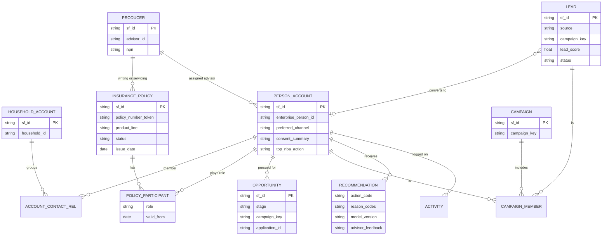
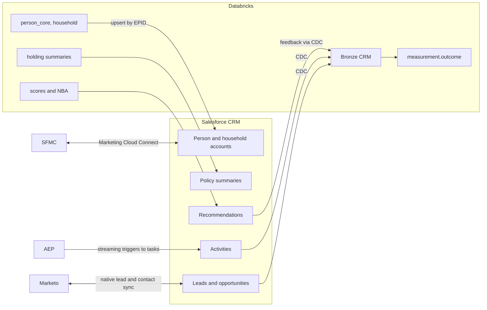
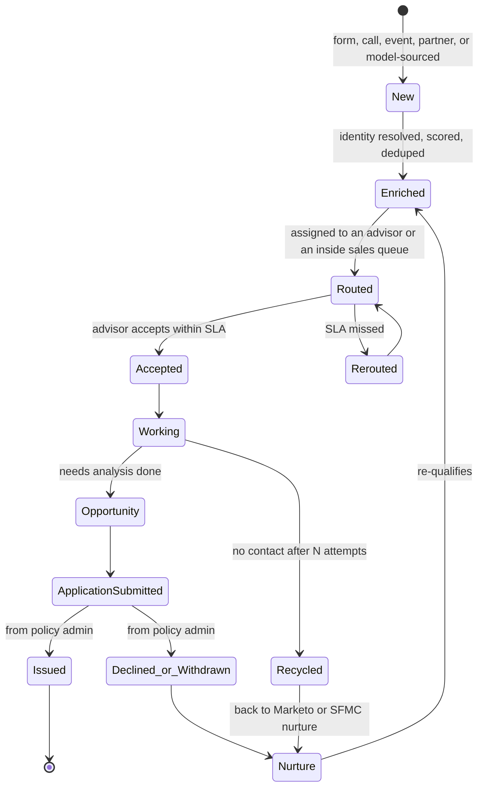

# Customer Relationship Management (CRM) Buildout

## 1. Purpose

Give advisors and service teams one view of each client and household, with marketing context, warm leads and next best actions, and capture what they do so outcomes flow back to measurement. The CRM is the **system of engagement** for advisors. It is not the identity system of record and not the policy system of record.

Assumed platform: Salesforce with the Financial Services Cloud data model (person accounts, households, insurance policies, producers). Object names below follow that model and should be checked against the org's licensed edition **(verify)**.

## 2. System Boundaries

| Fact | System of record | CRM role |
|---|---|---|
| Who a person is (`enterprise_person_id`) | Identity spine (Databricks) and master data management (MDM) | Stores the ID on the person record; never merges on its own |
| What a person holds | Policy admin systems | Read-only summary synced from the lakehouse |
| Advisor licensing and hierarchy | Distribution and licensing systems | Read-only producer records |
| Leads, opportunities, activities | **CRM** | Owns them |
| Consent and preferences | Consent platform, exposed in the profile | Read, plus capture of verbal consent through a controlled flow |
| Scores and next best action (NBA) | `ml.scores`, `ml.nba_ranked_actions` | Displayed with reason codes; advisor feedback captured |

## 3. Data Model

Design choices:

- **Person accounts plus household accounts** match the two-sided model from file 02. Household membership comes from the identity spine, not from advisors creating households by hand.
- **Policy participant roles** mirror `HOLDING_ROLE` (owner, insured, beneficiary), so an advisor sees that a client is also a beneficiary on a parent's policy.
- **`campaign_key` on lead, opportunity and campaign** is the taxonomy key from file 07. It is the join that makes closed-loop measurement possible.
- **`application_id` on the opportunity** links the CRM pipeline to the policy admin system's application, so issue and decline outcomes come from the system of record, not from advisors updating stages.
- **Recommendations with advisor feedback** (accepted, dismissed, reason) are a label source for the NBA model and a measure of advisor trust in it.

## 4. Integration

- **Into Salesforce:** a sync job (Databricks to Salesforce bulk API, or a reverse ETL tool) upserts person, household and policy summary records keyed on `enterprise_person_id`, and writes recommendations daily. It goes through the same policy check as other exception-path activations, because the CRM is a destination.
- **Out of Salesforce:** change data capture into Bronze, through a managed connector such as Databricks Lakeflow Connect's Salesforce connector or Salesforce CDC events **(verify the connector choice with the platform team)**.
- **Marketo and Salesforce Marketing Cloud (SFMC):** native connectors stay for operational sync (lead handoff and status in Marketo, subscriber context in SFMC). Audiences still come from upstream (file 04).

## 5. Lead Lifecycle and Routing

Routing rules, in order:

1. If the person already has an active servicing advisor, the lead goes to that advisor, unless the advisor is inactive or not licensed for the product in the person's state.
2. Otherwise, use the lead-to-advisor matching model (file 05, model 9) among eligible advisors, subject to capacity and fairness constraints.
3. Leads below a score threshold go to inside sales or nurture rather than to advisors, which protects advisor trust in the leads they receive.

Service levels: first contact attempt within 1 business hour for high-score leads and within 1 business day for others. Each service level agreement (SLA) miss is measured, because time to first contact is one of the strongest conversion drivers and a lever marketing can't pull by itself.

## 6. Offline Outcome Capture

Outcomes come from the system of record and are joined by keys, never typed in by hand.

| Outcome | Source | Join keys |
|---|---|---|
| Lead created | CRM | `lead_id`, `campaign_key`, `enterprise_person_id` |
| Meeting held | CRM activity | `enterprise_person_id`, `advisor_id` |
| Application submitted | Policy admin or e-application | `application_id` (also on the opportunity), `enterprise_person_id` |
| Policy issued, declined or withdrawn | Policy admin | `application_id`, `policy_number_token` |
| First-year premium | Policy admin or finance | `policy_number_token` |
| Lapse or surrender | Policy admin | `policy_number_token` |

These rows land in `measurement.outcome` with the event date and a restatement flag, because issue status can change for weeks after submission.

## 7. Buildout Phases

| Phase | Scope | Exit criteria |
|---|---|---|
| 1. Foundation | `EPID` on person accounts, household and policy summaries synced, duplicate cleanup | Under 2% duplicate person accounts; every active client has an `EPID` |
| 2. Leads | Lead intake from all sources, enrichment, routing, service level agreements (SLAs), Marketo sync | 100% of leads with `campaign_key`; SLA dashboard live |
| 3. Outcomes | `application_id` on opportunities, policy admin outcomes joined | 90% of issued policies traced to a lead or campaign touch within 90 days, or flagged as advisor-originated |
| 4. Intelligence | Scores and NBA recommendations with reason codes; feedback capture | Advisor acceptance rate tracked; holdout lift measured |
| 5. Expansion | Distribution and service use cases beyond marketing | Self-serve access with the same governance (file 07) |

## 8. Adoption Is the Real Risk

The best data model fails if advisors don't use it. The build includes:

- A single "client 360" page with holdings, household, recent marketing touches, open recommendations and consent at a glance.
- Recommendations that are few and explained (top three, each with a reason).
- Measuring advisor usage and recommendation acceptance by region, and reviewing it with distribution leadership monthly.

## 9. Interview Talk Track (2 minutes)

"The CRM is the system of engagement for advisors, not the system of record for identity or policies. Every person account carries the enterprise person ID from the spine, households come from the spine, and policy summaries are read-only from policy admin. The two keys I insist on are a campaign key on every lead and opportunity, and the application ID on the opportunity, because those are what let us join a policy issued six weeks later back to the campaign without asking advisors to update stages. Routing goes to the existing servicing advisor first, then a matching model with capacity rules. Low-score leads go to nurture so advisors keep trusting what they get. And I measure advisor adoption as hard as I measure lead conversion."
