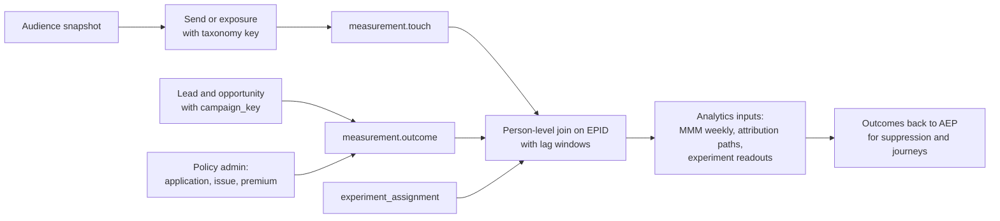

# Governance, Privacy and Measurement (Light)

These topics are covered in less depth here on purpose. This file pins down the decisions the deep files depend on.

## 1. One Label Taxonomy, Enforced in Two Platforms

Labels are defined once, in YAML in this repo (extending [config/governance/classification.yaml](../../config/governance/classification.yaml)), and pushed to both Unity Catalog tags and Adobe Experience Platform (AEP) data usage labels.

| Label family | Examples | Unity Catalog | AEP |
|---|---|---|---|
| Identity | Direct identifier, indirect identifier | Column tags drive masking and attribute-based access control (ABAC) | `I1`, `I2` |
| Contract | Vendor data licensed with no onsite use or no third-party export | Table tags | `C`-series contract labels |
| Sensitive | Precise location, financial account detail | Column tags | `S`-series and custom labels |
| Purpose restriction (custom) | `UW` underwriting, `HLTH` health, `CLM` claims detail, `NOMKT` not cleared for marketing | Separate catalog plus tags | Custom labels with policies denying marketing actions |
| Regulatory regime | `GLBA_NPI`, `CCPA_COVERED` | Table and column tags | Custom labels where activation behavior differs |

Each AEP destination declares its marketing actions (email marketing, onsite personalization, third-party export, cross-site targeting). Policies map labels to forbidden actions. That makes "this data can't be used for marketing" a configuration that fails closed, not a request for good behavior.

## 2. Purpose Limitation, Layer by Layer

When a marketer wants an audience using data Legal hasn't cleared:

1. **Catalog separation.** Underwriting, health and claims data live in a catalog that marketing principals cannot read. The segment's SQL fails to compile.
2. **Labels.** If a field slips into a marketing dataset, its `NOMKT` or `HLTH` label makes the AEP policy engine block the destination mapping and name the field.
3. **Segment continuous integration (CI).** The label check in file 03 blocks the pull request before anything reaches AEP.
4. **Score inheritance.** A model trained on a restricted field produces a score with the same restriction (file 05).
5. **Process.** The request goes to the data use review (Privacy and Legal) with the use case. If approved, the label is changed by the steward with an audit record. Nothing is unblocked by an override in a channel tool.

## 3. Consent and Preferences

- Consent is stored per person, per channel (email, SMS, phone, mail, onsite personalization) and per purpose, with source, timestamp and evidence (needed for Telephone Consumer Protection Act (TCPA)).
- The AEP profile carries the consent field group. Consent policies are evaluated at export time (file 04).
- The consent platform is the system of record. The lakehouse keeps the full history for audit, and the customer relationship management (CRM) can only capture verbal consent through a controlled flow that writes back to that system of record.
- The most restrictive applicable rule wins: a person who opted out of email on any identifier is suppressed for email on all identifiers resolved to them.
- Regulatory map, at a glance: Gramm-Leach-Bliley Act (GLBA) for nonpublic personal information and sharing notices; California Consumer Privacy Act and California Privacy Rights Act (CCPA/CPRA) for personal information outside GLBA's exemption (web behavior and prospect data are the usual examples); TCPA for calls and texts; CAN-SPAM for commercial email; state insurance privacy and AI rules. Check the current state of each with Privacy before the interview.

## 4. Data Product Governance (Summary)

| Practice | Implementation |
|---|---|
| Ownership | Every certified table, audience and score has an owner and steward in the catalog |
| Certification | Contract, service level agreement (SLA), quality tests and lineage are required to be listed as certified (extends [metadata/certification](../../metadata/certification)) |
| Quality service level agreements (SLAs) | Freshness, completeness, uniqueness and reconciliation per data product, with tests that block publish |
| Lineage | Unity Catalog lineage from source to Gold, plus AEP dataset and destination lineage, joined in the catalog so "source to activation" is one view |
| Access | ABAC on Unity Catalog tags; AEP role-based access by sandbox and label; self-serve access granted by label, not by table |

Self-serve beyond marketing (Distribution, HR) uses the same mechanism: new groups get a role whose access is defined by labels and purposes, so adding a team is a policy change, not a new copy of the data.

## 5. Closed-Loop Measurement

### Campaign Taxonomy Key

One key, generated by a taxonomy service and required at every send:

`{fiscal_year}-{business_owner}-{line_of_business}-{objective}-{channel}-{audience_id}-{creative_id}`

Example: `fy27-cns-annuity-xsell-email-cns_xsell_annuity_rollover_window_v1-c014`

The same key is stored on AEP destination runs, Marketo programs, Salesforce Marketing Cloud (SFMC) sends, paid media campaign names (or a lookup table), CRM campaigns, leads and opportunities.

### The Loop

- **Offline outcomes** come from policy admin by `application_id` and from the CRM by `campaign_key` (file 06). They join to touches on `enterprise_person_id` within a lag window set by the conversion lag model (file 05, model 11).
- **Holdouts.** Every certified recurring program keeps a randomized holdout recorded in `experiment_assignment` before the audience is exported.
- **Handoff to Analytics.** Analytics gets three certified inputs: `measurement.media_weekly` for marketing mix model (MMM), person-level touch paths for attribution, and experiment readouts. It does not get raw channel exports.

## 6. Interview Talk Track (1 minute)

"Purpose limitation is enforced in layers: restricted data lives in a catalog marketing can't read, labels make AEP block the destination and name the field, segment CI blocks the pull request, and scores inherit restrictions from their inputs. If Legal approves a new use, a steward changes the label with an audit trail, and nobody overrides anything in a channel tool. For measurement, one taxonomy key goes on every send, lead and opportunity, and outcomes come from policy admin by application ID, so a policy issued weeks later joins back to the touch."
