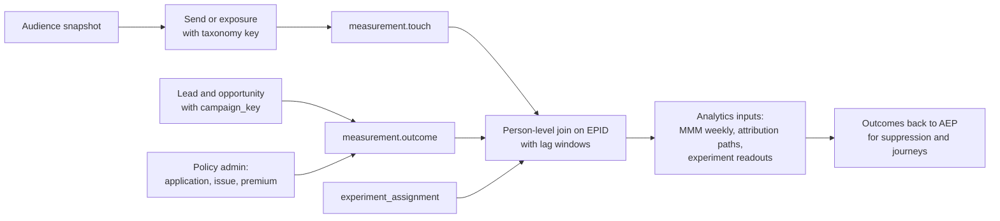

# Governance, Privacy and Measurement (Light)

These topics are covered in less depth here on purpose. This file pins down the decisions the deep files depend on.

## 1. One Label Taxonomy, Enforced in Two Platforms

Labels are defined once, in YAML in this repo (extending [config/governance/classification.yaml](../../config/governance/classification.yaml)), and pushed to both Unity Catalog tags and Adobe Experience Platform (AEP) data usage labels.

| Label family | Examples | Unity Catalog | AEP |
|---|---|---|---|
| Identity | Direct identifier, indirect identifier | Column tags drive masking and attribute-based access control (ABAC) | `I1`, `I2` |
| Contract | Vendor data licensed with no onsite use or no third-party export | Table tags | `C`-series contract labels |
| Sensitive | Precise location, financial account detail | Column tags | `S`-series and custom labels |
| Purpose restriction (custom) | `UW` underwriting, `HLTH` health, `CLM` claims detail, `NOMKT` not cleared for marketing | Separate catalog plus tags | Custom labels with policies denying marketing actions |
| Regulatory regime | `GLBA_NPI`, `CCPA_COVERED` | Table and column tags | Custom labels where activation behavior differs |

Each AEP destination declares its marketing actions (email marketing, onsite personalization, third-party export, cross-site targeting). Policies map labels to forbidden actions. That makes "this data can't be used for marketing" a configuration that fails closed, not a request for good behavior.

### Example: the three gates with real data

The examples follow Jane Doe (`p42`) through `wkp_xsell_life_group_only_households_v1`, which is mapped to `sfmc_consumer` for email.

**Gate 1: labels on the metadata.** Unity Catalog tags and AEP field labels come from the same YAML list.

| Field (profile.person_core) | Unity Catalog column tags | AEP field labels | Marketing actions the labels forbid |
|---|---|---|---|
| `enterprise_person_id` | `identity=direct` | `I1` | None on its own |
| `email` | `identity=direct`, `pii` | `I1` | Third-party export unless hashed |
| `has_group_life` | `regime=GLBA_NPI` | `GLBA_NPI` | Third-party export |
| `has_individual_life` | `regime=GLBA_NPI` | `GLBA_NPI` | Third-party export |
| `underwriting_class` | `purpose=UW`, `NOMKT` | `UW`, `NOMKT` | All marketing actions |
| `health_condition_flag` | `purpose=HLTH`, `NOMKT` | `HLTH`, `NOMKT` | All marketing actions |

The audience inherits `I1` and `GLBA_NPI`, and neither label forbids `email_marketing`, so the mapping passes. If `underwriting_class` were added to the logic, the audience would inherit `NOMKT` and the mapping would be blocked:

```text
POLICY VIOLATION  audience=wkp_xsell_life_group_only_households_v1  destination=sfmc_consumer
  marketing_action: email_marketing
  field: person_core.underwriting_class   labels: [UW, NOMKT]
  policy: "No marketing use of underwriting data"  -> DENY
```

**Gate 2: one person's consent row**, checked per person at every export.

```json
{
  "enterprise_person_id": "p42",
  "consents": {
    "collect":     { "val": "y" },
    "share":       { "val": "n" },
    "personalize": { "content": { "val": "y" } },
    "marketing": {
      "email": { "val": "y", "time": "2026-03-14T10:02:00Z", "source": "web_preference_center" },
      "sms":   { "val": "n", "time": "2026-05-02T18:40:00Z", "source": "sms_stop_reply" },
      "call":  { "val": "y" },
      "preferred": "email"
    }
  },
  "jurisdiction": "NJ"
}
```

| Export of p42 to | Consent checked | Result |
|---|---|---|
| SFMC email journey | `marketing.email = y` | Sent |
| SFMC SMS journey | `marketing.sms = n` | Dropped from this export only |
| Paid media custom audience | `share = n` | Dropped from this export only |

**Gate 3: the destination allow-list** in the segment file.

```yaml
marketing_action: email_marketing
destinations: [sfmc_consumer]   # certified at sign-off; adding one needs a new review
```

| Mapping attempt | In `destinations`? | Result |
|---|---|---|
| `sfmc_consumer` | Yes | Allowed, then gates 1 and 2 run |
| `marketo_advisor` | No | Refused: "audience not certified for marketo_advisor" |
| `meta_custom_audience` | No | Refused, and gate 1 would also block it on `GLBA_NPI` |

### Where a Semantic Model Sits

The semantic model lives in Databricks, between the Gold tables and everything that reads them. It defines each business concept once, along with its label. AEP never reads it directly.

| Layer | What lives there |
|---|---|
| Gold tables | `profile.person_core`, holdings, consent, send log |
| **Semantic model** (Unity Catalog metric views) | Named dimensions and measures with labels: `has_individual_life` (GLBA_NPI), `email_reachable`, `email_response_rate` |
| Readers | Segment SQL that FAC reads, dashboards and Genie, analyst notebooks, the measurement mart |
| AEP | Receives the results with labels already set on each field (gate 1). It does not read the model. |

```yaml
# metric view: marketing_person (excerpt)
source: gold.profile.person_core
dimensions:
  - name: has_individual_life
    expr: has_individual_life
    tags: {regime: GLBA_NPI}               # labelled once; every reader inherits it
  - name: email_reachable
    expr: consents.marketing.email = 'y'   # consent rule written once
measures:
  - name: email_response_rate
    expr: sum(clicked) / nullif(sum(delivered), 0)
```

## 2. Purpose Limitation, Layer by Layer

When a marketer wants an audience using data Legal hasn't cleared:

1. **Catalog separation.** Underwriting, health and claims data live in a catalog that marketing principals cannot read. The segment's SQL fails to compile.
2. **Labels.** If a field slips into a marketing dataset, its `NOMKT` or `HLTH` label makes the AEP policy engine block the destination mapping and name the field.
3. **Segment continuous integration (CI).** The label check in file 03 blocks the pull request before anything reaches AEP.
4. **Score inheritance.** A model trained on a restricted field produces a score with the same restriction (file 05).
5. **Process.** The request goes to the data use review (Privacy and Legal) with the use case. If approved, the label is changed by the steward with an audit record. Nothing is unblocked by an override in a channel tool.

## 3. Consent and Preferences

- Consent is stored per person, per channel (email, SMS, phone, mail, onsite personalization) and per purpose, with source, timestamp and evidence (needed for Telephone Consumer Protection Act (TCPA)).
- The AEP profile carries the consent field group. Consent policies are evaluated at export time (file 04).
- The consent platform is the system of record. The lakehouse keeps the full history for audit, and the customer relationship management (CRM) can only capture verbal consent through a controlled flow that writes back to that system of record.
- The most restrictive applicable rule wins: a person who opted out of email on any identifier is suppressed for email on all identifiers resolved to them.
- Regulatory map, at a glance: Gramm-Leach-Bliley Act (GLBA) for nonpublic personal information and sharing notices; California Consumer Privacy Act and California Privacy Rights Act (CCPA/CPRA) for personal information outside GLBA's exemption (web behavior and prospect data are the usual examples); TCPA for calls and texts; CAN-SPAM for commercial email; state insurance privacy and AI rules. Check the current state of each with Privacy before the interview.

## 4. Data Product Governance (Summary)

| Practice | Implementation |
|---|---|
| Ownership | Every certified table, audience and score has an owner and steward in the catalog |
| Certification | Contract, service level agreement (SLA), quality tests and lineage are required to be listed as certified (extends [metadata/certification](../../metadata/certification)) |
| Quality service level agreements (SLAs) | Freshness, completeness, uniqueness and reconciliation per data product, with tests that block publish |
| Lineage | Unity Catalog lineage from source to Gold, plus AEP dataset and destination lineage, joined in the catalog so "source to activation" is one view |
| Access | ABAC on Unity Catalog tags; AEP role-based access by sandbox and label; self-serve access granted by label, not by table |

### ABAC Examples

In Unity Catalog, a policy is written once against a tag and applies automatically to every table or column that carries the tag. Nobody grants access table by table.

| Policy | Applies to | Effect |
|---|---|---|
| Mask direct identifiers | Columns tagged `pii=direct` (email, phone, SSN, date of birth) | Shown hashed or masked to everyone except the activation service account and a small PII group. Analysts can still join on the hashed value |
| Wall off restricted data | Tables tagged `domain=underwriting`, `health` or `claims` | Readable only by underwriting and claims groups. Every marketing group and service account is denied, including on new tables that carry the tag |
| Training only on allowed inputs | Columns tagged `usage=no_marketing_model` or `protected_class` | Hidden from the ML training service account, so a feature set cannot pull them in by accident |
| Advisor channel boundaries | Rows tagged with distribution channel (career agency or independent broker-dealer) | The CRM sync for one channel sees only its own advisors' books |
| Product boundaries (Benge Software) | Rows by `product_id` | A product team sees only its own product's users and events |

Self-serve beyond marketing (Distribution, HR) uses the same mechanism: new groups get a role whose access is defined by labels and purposes, so adding a team is a policy change, not a new copy of the data.

### Freshness and Quality KPIs

These are what a data product contract promises and the daily scorecard reports. The last column is an example morning. A miss pages the owner, and a miss on a certified product blocks publishing until it is fixed or waived.

| Type | Data product | KPI | Target | Example day |
|---|---|---|---|---|
| Freshness | Gold profile (person_core) | Ready by 05:00 ET | On time 99% of days | Today 04:41 |
| Freshness | Batch scores in AEP | Score age when read | Under 26 hours | Today 22 h |
| Freshness | Batch audience | Gold ready to row in SFMC or Marketo | Under 2 hours | Today 1 h 23 min |
| Freshness | Streaming audience | Event to row in the channel, p95 | Under 15 minutes | Today 6 min |
| Freshness | Edge decision | Request to response, p95 | Under 150 ms | Today 96 ms |
| Freshness | Consent | Opt-out to every channel suppressed | Under 1 hour streaming, next run for batch (legal limit is 10 business days for email) | Today 38 min |
| Freshness | Outcomes (applications) | Prior day complete | By 08:00 ET | Today 09:15 (miss) |
| Quality | Identity | False merges on the labelled golden set | Under 0.1% | 0.04% |
| Quality | Identity | People sharing a hard key such as SSN token | Under 0.5% | 0.3% |
| Quality | Profile core | Exactly one row per EPID | 100% | 100% |
| Quality | Profile core | Contactable people with a valid email and a consent value | At least 97% | 98.2% |
| Quality | Audiences | AEP count vs. channel count, per destination | Within 1% | 0.4% |
| Quality | Audiences | AEP audience vs. its SQL twin | Within 2% (alert after 2 days) | 3.1% day 1 (watch) |
| Quality | Activation | Sends carrying a campaign_key | 100% of new sends | 99.6% (miss) |
| Quality | Activation | Destination records failed | Under 1% | 0.2% |
| Quality | Scores | Population stability index (PSI) vs. training | Under 0.1; alert above 0.25 | 0.07 |

## 5. Closed-Loop Measurement

### Campaign Taxonomy Key

One key, generated by a taxonomy service and required at every send:

`{fiscal_year}-{business_owner}-{line_of_business}-{objective}-{channel}-{audience_id}-{creative_id}`

Example: `fy27-cns-annuity-xsell-email-cns_xsell_annuity_rollover_window_v1-c014`

The same key is stored on AEP destination runs, Marketo programs, Salesforce Marketing Cloud (SFMC) sends, paid media campaign names (or a lookup table), CRM campaigns, leads and opportunities.

### The Loop



- **Offline outcomes** come from policy admin by `application_id` and from the CRM by `campaign_key` (file 06). They join to touches on `enterprise_person_id` within a lag window set by the conversion lag model (file 05, model 11).
- **Holdouts.** Every certified recurring program keeps a randomized holdout recorded in `experiment_assignment` before the audience is exported.
- **Handoff to Analytics.** Analytics gets three certified inputs: `measurement.media_weekly` for marketing mix model (MMM), person-level touch paths for attribution, and experiment readouts. It does not get raw channel exports.

## 6. Interview Talk Track (1 minute)

"Purpose limitation is enforced in layers: restricted data lives in a catalog marketing can't read, labels make AEP block the destination and name the field, segment CI blocks the pull request, and scores inherit restrictions from their inputs. If Legal approves a new use, a steward changes the label with an audit trail, and nobody overrides anything in a channel tool. For measurement, one taxonomy key goes on every send, lead and opportunity, and outcomes come from policy admin by application ID, so a policy issued weeks later joins back to the touch."
