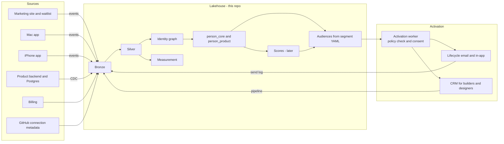

# Benge Software Instance

## 1. Context

Benge Software LLC sells practical software for AI-assisted engineering. Its first product, **MakeItOurs**, turns plain-language requests into parametric CAD changes that are validated, previewed in 3D, versioned in Git and exported (STEP, IFC4, GLB and others). Its users are homeowners, DIY builders, small builders and designers. It is pre-launch, with Mac and iPhone apps in testing, and more products are planned.

This file applies the enterprise design to that business at a founder's budget. The logical architecture stays the same. The tools get smaller, and AEP's role is played by tables in the lakehouse plus a small activation worker.

Event names and lifecycle stages below are proposals. They should be checked against what the product actually emits before anything is built.

## 2. What Changes and What Stays

| Enterprise component | Benge Software equivalent | Stays the same |
|---|---|---|
| AEP Identity Service and Real-Time Profile | `identity` and `profile` tables built by dbt or Spark from this repo's Silver layer; a small Postgres table for lookups | Two graphs, stable IDs, merge and split events |
| AEP segmentation | Segment YAML compiled to dbt models | Segments as code, owners, expected size, expiry |
| AEP destinations and policy engine | An activation worker (or a reverse ETL tool) with a policy check | Consent at send time, labels, send log |
| Marketo (B2B) | A lightweight CRM for builders and designers | Upstream audiences, taxonomy key |
| SFMC (B2C) | One lifecycle email and in-app messaging tool | Upstream audiences, taxonomy key |
| Databricks | This repo's lakehouse (Iceberg, Spark, dbt, Trino) until volume justifies a managed platform | Unity-Catalog-style labels in YAML |
| MLflow models | Rules first; simple models later, tracked in the sibling `example-model-routing` repo | Scores as data products |

Tool picks (email, CRM, event collection) are deliberately left open. The contracts in this folder are what need to stay stable, so tools can be swapped later.

## 3. Architecture

## 4. Multi-Product Rules

- Every event, holding and audience carries `product_id` (`makeitours` first).
- One person has one `person_id` across all Benge products. A single Benge account is the natural hard key.
- Per-product state lives in `profile.person_product` (`person_id`, `product_id`, `lifecycle_stage`, `first_seen_at`, `activated_at`, `plan`, `last_active_at`), so a person can be a paying MakeItOurs user and a waitlist member for the next product.
- Segment naming adds the product: `{product}_{purpose}_{descriptor}_v{n}`, for example `mio_onb_first_export_7d_v1`. Cross-product audiences use `multi`.
- Consent is per brand and per product where the product sends its own messages, with one global unsubscribe.

## 5. Identity

| Namespace | Source | Strength |
|---|---|---|
| `account_id` | Product backend | Hard key |
| `email_sha256` | Waitlist, sign-up, billing | Strong |
| `github_user_id` | Connected GitHub account, when the user chooses to connect | Hard key |
| `device_id` | Mac and iPhone apps | Device |
| `anonymous_id` | Marketing site | Browser |
| `billing_customer_id` | Billing provider | Hard key within source |

The two-sided model maps directly: a homeowner owns a project, and a builder or designer collaborates on it. Collaboration is a relationship edge (`project_collaborator`), never identity evidence. A builder who works with ten homeowners is ten edges, not one giant cluster.

Hosted sharing and collaboration are planned features, not released ones. The model is in place now so it doesn't need a migration later.

## 6. Data Boundary: Product Content Is Not Marketing Data

This is the most important rule for this instance, and it is a trust differentiator for a product whose users keep their source and history in their own Git repositories.

- Project source, prompts, models, drawings and repository contents are **never** ingested into the marketing lakehouse.
- Only metadata events are collected (for example, "a change was requested", "a build failed", "a model was exported as STEP"), with no content payload.
- Users on the bring-your-own-infrastructure path send only the telemetry they opt into.
- Labels enforce it: any column derived from project content would carry `PRODUCT_CONTENT`, which the activation worker refuses for every marketing action.

## 7. Proposed Event Taxonomy (MakeItOurs)

| Event | Key properties | Used for |
|---|---|---|
| `waitlist_joined` | persona (homeowner, DIY, builder, designer), source | Acquisition, launch sequencing |
| `app_installed` | platform | Activation funnel |
| `account_created` | signup_source | Identity, funnel |
| `github_connected` | none (ID stored in identity, not on the event) | Identity, power-user signal |
| `project_created` | template_used | Activation |
| `change_requested` | request_count_in_session | Engagement depth |
| `change_accepted` / `change_rejected` | follow_ups_needed | Quality and satisfaction proxy |
| `build_failed` | error_class | "Stuck" detection |
| `model_exported` | format | Activation milestone (first export) |
| `collaborator_invited` / `collaborator_joined` | collaborator_persona | Two-sided growth, builder pipeline |
| `subscription_started` / `subscription_canceled` | plan | Revenue outcomes |

## 8. Starter Audiences

| Audience | Logic | Action |
|---|---|---|
| `mio_onb_no_project_3d_v1` | Account created, no project after 3 days | Onboarding email with templates |
| `mio_onb_first_export_7d_v1` | First `model_exported` within 7 days of sign-up | Celebrate; ask for feedback |
| `mio_svc_stuck_builds_v1` | 3 or more `build_failed` in a session without an accepted change | Help content; founder outreach early on |
| `mio_acq_builder_pql_v1` | Builder or designer persona, 2 or more projects, invited collaborators | CRM pipeline for a builder offer |
| `mio_grow_invited_not_joined_v1` | Invited 7 days ago, not joined | Reminder to the inviter, not the invitee, until the invitee consents |
| `multi_acq_waitlist_next_product_v1` | Active MakeItOurs users matching the next product's persona | Cross-product launch |

## 9. ML Path

1. **Rules now.** Lifecycle stages and the audiences above.
2. **First models when there is volume:** activation propensity (will a new user export within 7 days?), churn risk for subscribers, and product-qualified lead scoring for builders and designers.
3. **Later:** uplift on onboarding interventions once holdouts exist, and lifetime value by persona to guide acquisition spend.

The feature and score contracts are the same as file 05. That means the enterprise playbook and the startup implementation stay one body of work.

## 10. Phases

| Phase | Scope |
|---|---|
| 0. Pre-launch | Event taxonomy, waitlist with persona and consent capture, `person_id` from day one |
| 1. Launch | Identity graph (account, email, device, anonymous), `person_product`, three onboarding audiences, send log with taxonomy keys |
| 2. Growth | Builder CRM pipeline, collaboration edges, activation propensity model, holdouts on lifecycle email |
| 3. Second product | `product_id` already everywhere; cross-product audiences and consent per product |

## 11. Why This Is Reusable

The same folder serves three uses:

- An interview and consulting artifact that shows an enterprise activation design with real tradeoffs.
- The working spec for Benge Software's own growth data.
- A template for future clients or products. Swap the vendor column, keep the contracts.
