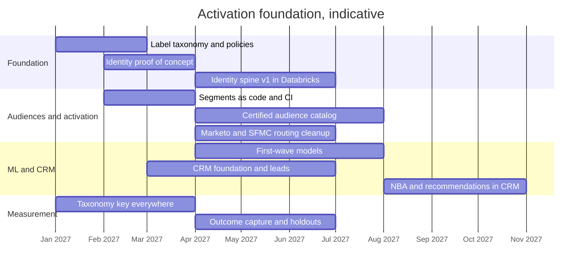

# Roadmap (Light)

## 1. First 90 Days

| Window | Focus | Concrete outputs |
|---|---|---|
| Days 1 to 30: listen and baseline | Meet Marketing, Analytics, EDO, Technology, Privacy, Legal and Distribution. Inventory sources, AEP schemas, audiences, destinations and list-pull requests | Current-state map; top 20 list pulls by volume; baseline metrics (time to audience, duplicate rate, share of sends with a taxonomy key) |
| Days 31 to 60: decide and prove | Identity proof of concept kickoff (file 02, section 10); certify the first three audiences as code; agree the label taxonomy with Privacy | Bake-off golden set; three certified audiences live with shadow evaluation; signed label-to-policy table |
| Days 61 to 90: ship and show | Taxonomy key required on all new sends; first closed-loop readout on one program with a holdout; data product portfolio and prioritization agreed | One program measured end to end; portfolio roadmap for the next two quarters |

## 2. Delivery Phases

Dates are placeholders to show sequencing, not commitments.

## 3. Prioritizing the Data Product Portfolio

When every request is urgent, score each candidate data product:

| Factor | Question | Weight |
|---|---|---|
| Value | Revenue or cost impact if it exists, estimated with the requester | 30% |
| Reuse | How many teams and programs would use it | 25% |
| Risk reduction | Does it remove a compliance or privacy exposure? | 20% |
| Readiness | Are the sources, identity and owner in place? | 15% |
| Effort | Inverse of build size | 10% |

Anything that removes a compliance exposure is fast-tracked regardless of score. The ranked list is published, so everyone sees why their request sits where it does.
